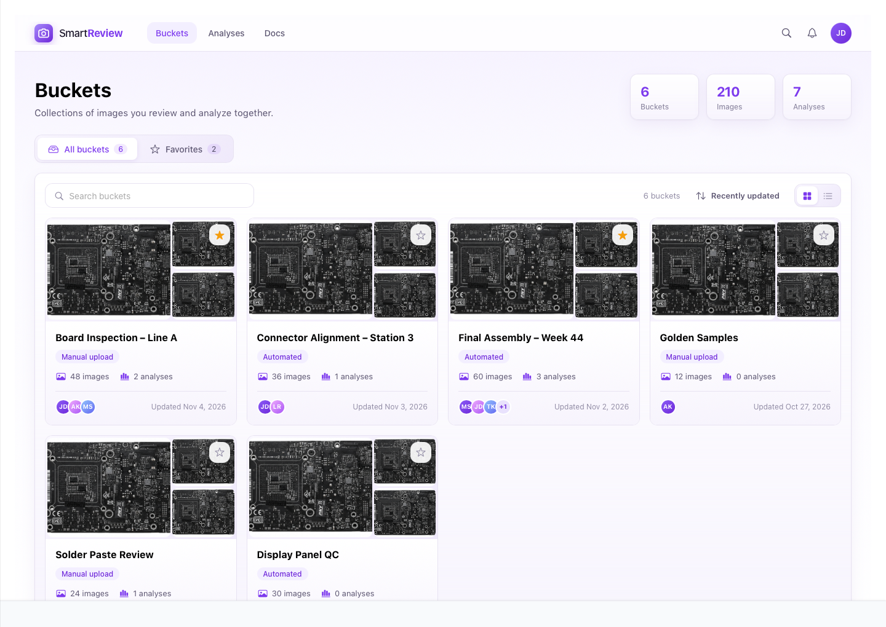
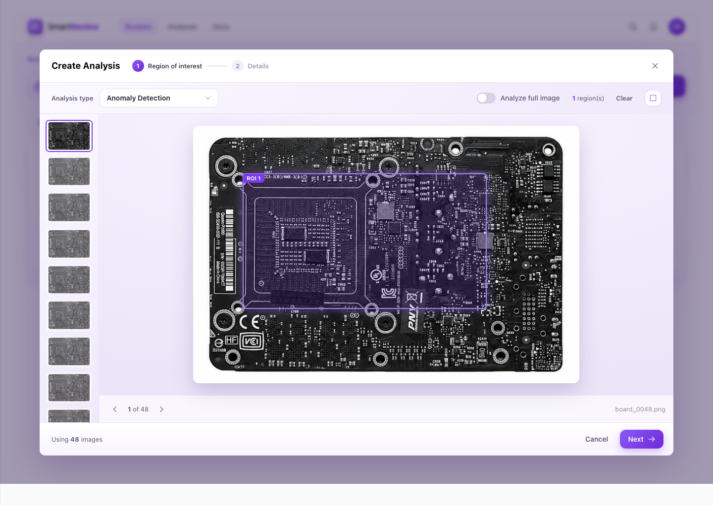
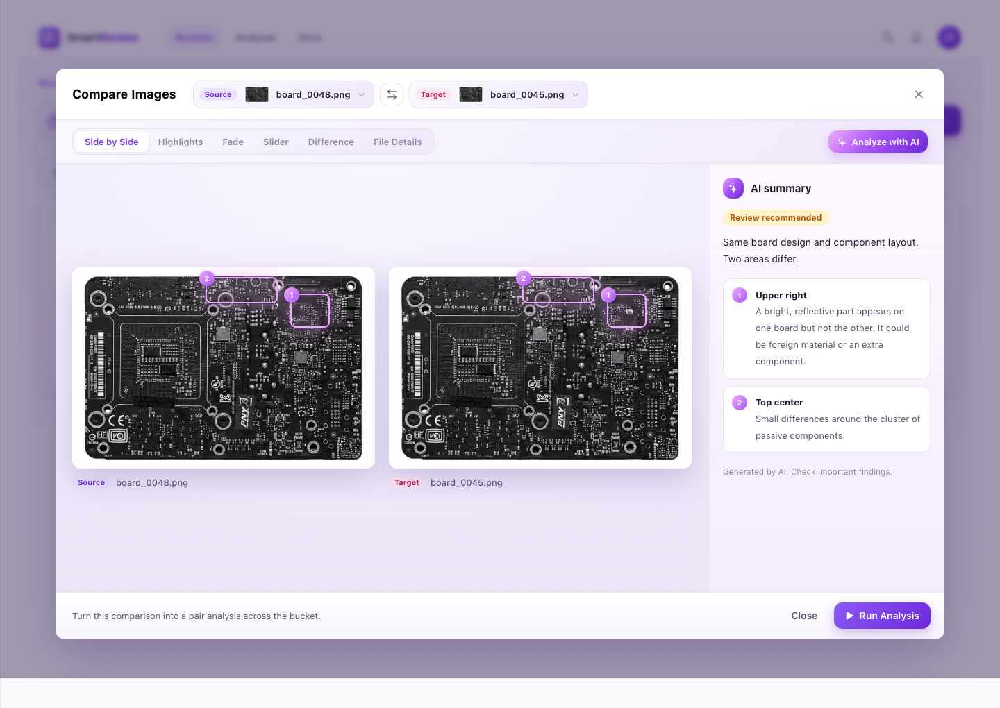
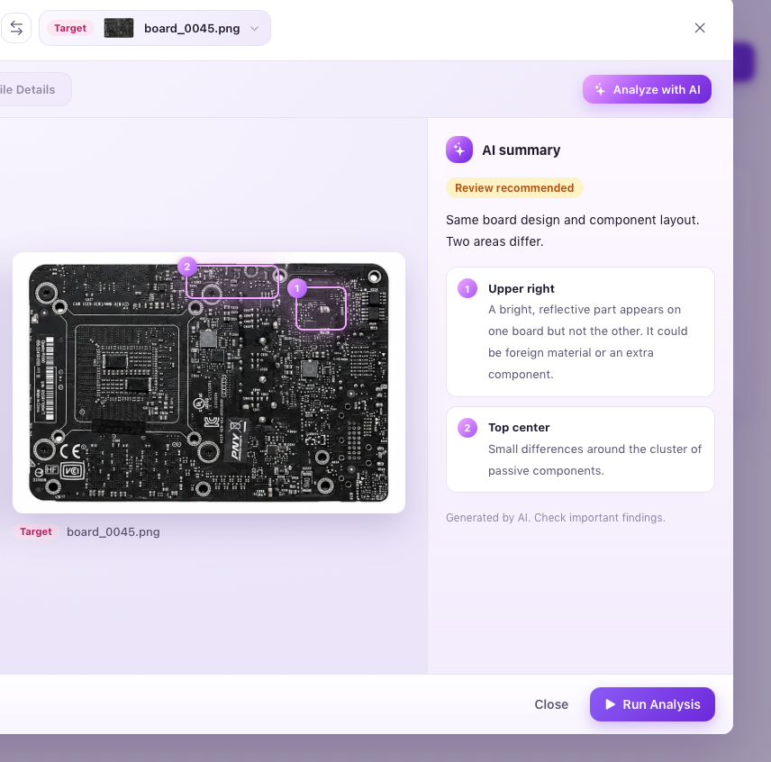

Every day, factories photograph thousands of products as they move down the line. Somewhere in those images there might be a missing component, a misaligned connector or a stray piece of debris. Finding them by eye doesn't scale, and missing them is expensive.

## Overview {#overview}

SmartReview is a web tool that helps quality engineers organize product images, compare them, and run AI analyses that point out anomalies. I designed it from the ground up around one idea: someone new to the tool should understand it in minutes, and the product should be able to tell its own story in a short demo.

## The problem {#problem}

Quality engineers working with inspection images face a recurring set of challenges:

:::cards
### Volume
Hundreds or thousands of near-identical images, where the interesting ones are the exceptions.
### Subtle differences
Defects are often tiny: a reflective speck, a missing part, a label printed slightly off. They're easy to overlook when scanning images one by one.
### Technical barriers
AI-based inspection is powerful, but setting it up usually means understanding algorithms, parameters and region definitions before getting any value.
### Trust
When an AI says "this board is different," engineers need to see where and why before acting.
### Waiting
Analyses over large image sets take time, and users need to know their work is progressing.
:::

## Goals {#goals}

1. **Make the core workflow obvious.** Organize images, compare them, run an analysis, see results.
2. **Speak the user's language.** Use words that describe what things are and what people want to do.
3. **Let people show, not configure.** Point at what matters directly on the image.
4. **Build trust in AI output.** Results should be explainable, pointable and honest about their limits.
5. **Create a calm, modern visual identity** that works for daily use and looks great in screenshots and short demo videos.

## Key design decisions {#decisions}

### 1. A vocabulary people already use

I built the product around two simple concepts:

- **Buckets:** a container you drop related images into, like a production line, a station or a set of golden samples.
- **Analyses:** what you ask SmartReview to do with a bucket, such as detect anomalies, compare pairs or map variation.

Together they make the product readable as plain sentences: "Create an analysis on this bucket." Every label, button and empty state follows from these two words.

### 2. A clear home: Buckets

The landing page gives an at-a-glance view of the workspace: total buckets, images and analyses, followed by bucket cards. Each card shows a mosaic of its images, how many images and analyses it holds, who's involved, and when it was last updated. Users can switch between cards and a compact list, search, sort, and star favorites for quick access.

When an analysis is running inside a bucket, its card shows a small live chip. Background work is visible from anywhere.

### 3. Three moves, one hierarchy

Inside a bucket, the page is built around three actions:

- **Browse** with search, grid or list, zoom and sort
- **Compare Images**, a secondary button
- **Create Analysis**, the one primary button

Selecting images changes the toolbar into a contextual selection bar offering only what makes sense for that selection: Compare (when exactly two images are selected) or Create Analysis. The interface reacts to intent instead of showing everything up front.

### 4. Drawing instead of configuring

To tell SmartReview where to look, you simply drag a rectangle on the image. A floating hint invites the first drag and fades away once you've drawn a region. Each region is labeled, can be removed on hover, and applies to every image in the analysis. A single "Analyze full image" switch covers the common shortcut.

Creating an analysis takes two steps: **Region of interest** and **Details**. The second step shows a live preview of the regions you drew next to a summary of the type, image count and bucket. Users always see what they're about to run.

### 5. Image comparison as a first-class tool

Often the most important question is simply "What's different between these two?" So I designed a dedicated comparison view with six ways to look at two images:

| Mode | What it answers |
| --- | --- |
| Side by Side | "Show me both." |
| Highlights | "Where are the differences?" Changes glow over a dimmed base. |
| Fade | "What changes as I blend them?" |
| Slider | "Let me sweep across and see." |
| Difference | "Show me the raw pixel difference." |
| File Details | "Are the files themselves different?" Mismatched fields are emphasized. |

Comparison can start from three natural moments: the bucket header, a two-image selection, or the image viewer ("Compare with another image"). SmartReview suggests a sensible partner image automatically, so a comparison is always one click away.

### 6. AI that shows its work

The **Analyze with AI** action returns a short, plain-language summary: a verdict ("Review recommended"), one sentence of context, and a numbered list of findings. Each finding is tied to a numbered box drawn directly on the image, so the explanation and the evidence live together.

Two details build trust:

- The AI is explicit when there's nothing to report ("These two images are identical") or when a comparison isn't reliable ("One photo is shifted. Align the images before comparing details."). Admitting uncertainty is part of the design.
- A quiet footnote reminds users the summary is AI-generated and that important findings should be checked.

From there, **Run Analysis** turns a single comparison into a full pair analysis across the bucket, already configured.

### 7. Making waiting visible

Once an analysis is submitted, the user lands on the bucket's Analyses tab and sees the new item at the top with a live progress bar. When it finishes, a toast confirms completion and the item shows how many images were flagged for review.

### 8. A softer visual language

Industrial software often feels heavy: dark chrome, hard edges, gray on gray. I wanted SmartReview to feel approachable without losing precision.

- **Purple as the signature color**, used sparingly for primary actions, selection and focus
- **12px rounded corners** on every surface, control and image, for a consistent, friendly rhythm
- **Soft lavender gradients** instead of flat gray panels, giving depth without visual noise
- **A camera mark as the logo:** a simple outline on a gradient tile that says "images" at a glance
- **Gentle motion:** cards lift on hover, AI findings fade in one by one, progress fills smoothly

## Challenges and how I solved them {#challenges}

:::principles
### Keeping a powerful tool focused
Visual inspection can involve many capabilities: tagging, exporting, measuring, playback and more. I scoped SmartReview around the shortest path to value: organize → compare → analyze → review. Each candidate feature was tested against one question: does it help someone finish that path? Everything else stays out of the way.
### Explaining "difference" visually
Raw pixel difference is accurate but hard to read. Pure AI summaries are readable but hard to verify. The answer was layering: Difference for the raw truth, Highlights for a readable version of it, and AI boxes that connect the narrative to exact locations.
### Staying honest with sample content
The prototype runs on generic sample images. Rather than invent findings, I wrote the AI examples from measured differences between the sample photos, so what the AI "says" matches what you can actually see on screen.
### Designing for presentations as well as daily use
SmartReview needed to look good in screenshots and short screen recordings. That shaped details like clear empty states, short and satisfying loops (draw → name → run → watch it complete), and animations timed to read well on video.
:::

<!-- ## Outcome {#outcome}

The result is an interactive, end-to-end prototype covering the full story:

:::callout
Buckets → Gallery → Compare → AI summary → Create Analysis → Live results
:::

It works as a design reference for building the product and as a storytelling tool for stakeholders: it explains what SmartReview does in under two minutes, without slides or jargon.

:::prototype title="Explore the SmartReview prototype" url="" embed=""
Walk through the full story: buckets, gallery, comparison, AI summary, analysis creation and live results.
::: -->

## What I learned {#learned}

:::cards
### Words are interface
Choosing two clear concepts, buckets and analyses, shaped every other decision.
### Direct manipulation beats configuration
Letting people draw what they mean removes a whole class of errors and explanations.
### AI needs a pointer, not just a paragraph
Tying every claim to a spot on the image is what turns output into evidence.
### Designing for the demo improves the product
When every step must read clearly on screen, unclear steps have nowhere to hide.
:::

*Names, data and brand details are fictional or omitted to protect confidentiality.*
