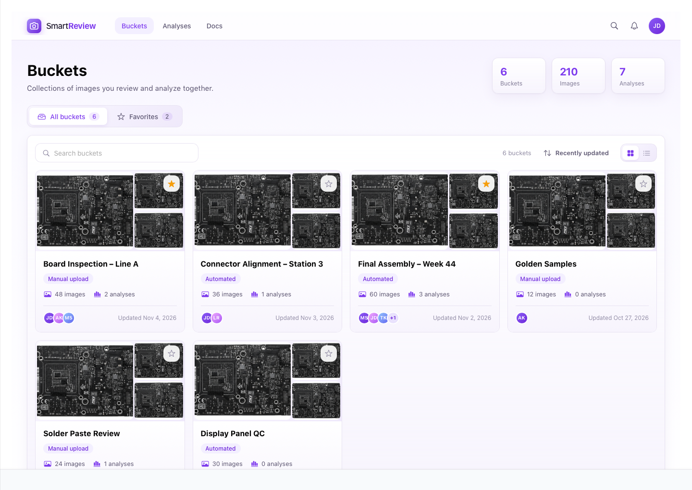
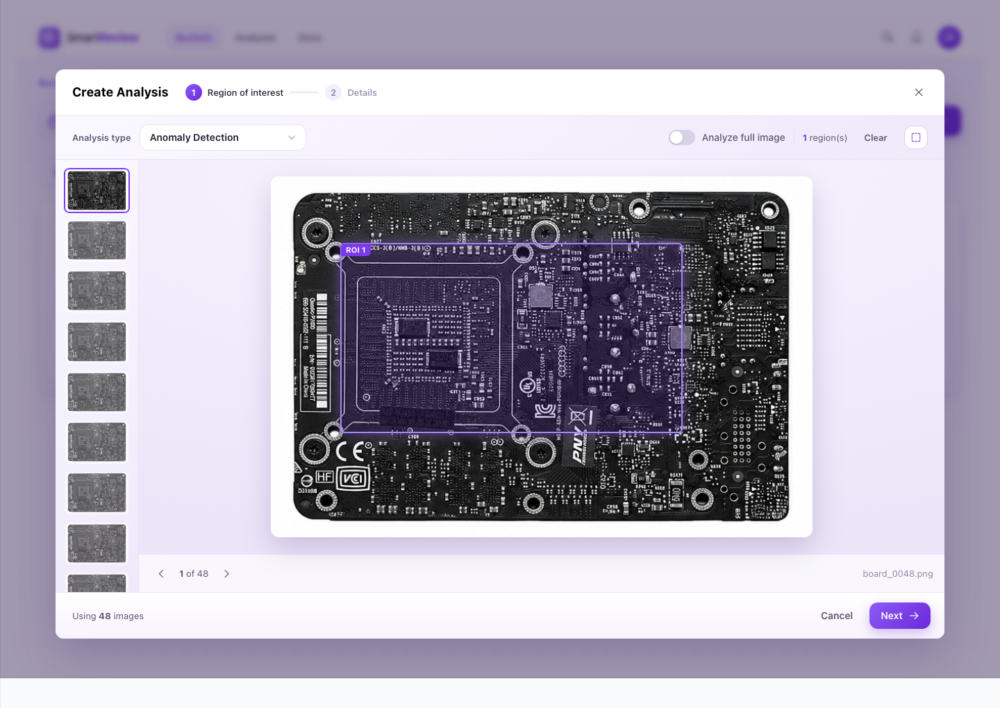
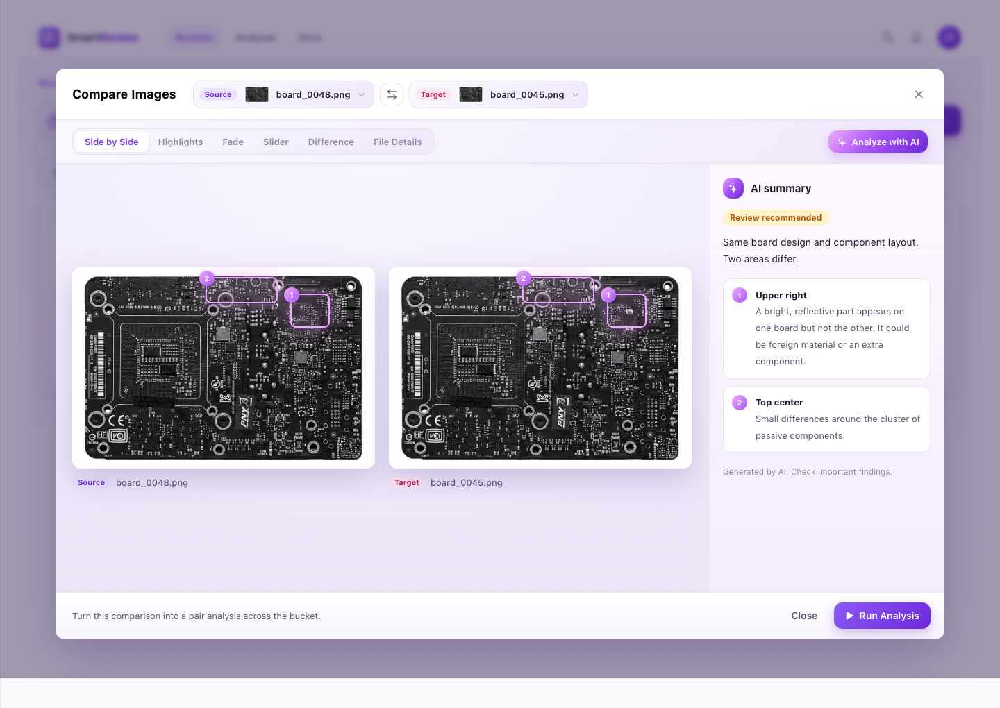
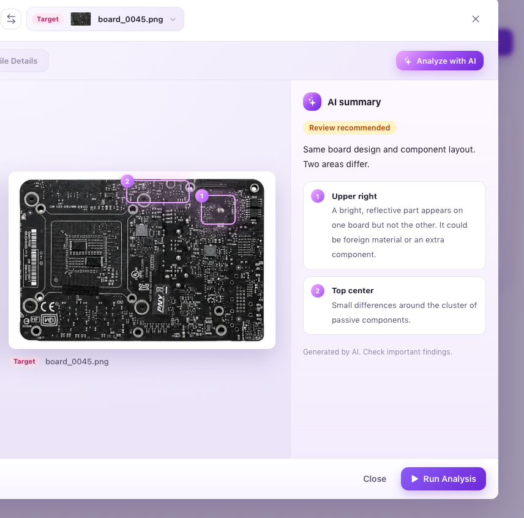

Todos os dias, fábricas fotografam milhares de produtos enquanto eles avançam pela linha de produção. Em algum lugar dessas imagens pode haver um componente faltando, um conector desalinhado ou um resíduo fora do lugar. Encontrar isso a olho nu não escala, e deixar passar custa caro.

## Visão geral {#overview}

O SmartReview é uma ferramenta web que ajuda engenheiros de qualidade a organizar imagens de produtos, compará-las e executar análises com IA que apontam anomalias. Desenhei a ferramenta do zero em torno de uma ideia: quem chega pela primeira vez deve entendê-la em minutos, e o produto deve conseguir contar a própria história em uma demo curta.

## O problema {#problem}

Engenheiros de qualidade que trabalham com imagens de inspeção enfrentam um conjunto recorrente de desafios:

:::cards
### Volume
Centenas ou milhares de imagens quase idênticas, em que as interessantes são as exceções.
### Diferenças sutis
Os defeitos costumam ser minúsculos: um ponto de reflexo, uma peça faltando, uma etiqueta impressa um pouco fora do lugar. É fácil deixá-los passar ao revisar imagens uma a uma.
### Barreiras técnicas
A inspeção com IA é poderosa, mas configurá-la normalmente exige entender algoritmos, parâmetros e definições de regiões antes de obter qualquer valor.
### Confiança
Quando uma IA diz "esta placa está diferente", os engenheiros precisam ver onde e por quê antes de agir.
### Espera
Análises em grandes conjuntos de imagens levam tempo, e os usuários precisam saber que o trabalho está avançando.
:::

## Objetivos {#goals}

1. **Tornar o fluxo principal óbvio.** Organizar imagens, compará-las, executar uma análise, ver os resultados.
2. **Falar a língua do usuário.** Usar palavras que descrevem o que as coisas são e o que as pessoas querem fazer.
3. **Deixar as pessoas mostrarem, em vez de configurarem.** Apontar o que importa diretamente na imagem.
4. **Gerar confiança nos resultados da IA.** Os resultados devem ser explicáveis, localizáveis e honestos sobre seus limites.
5. **Criar uma identidade visual calma e moderna** que funcione no uso diário e fique ótima em capturas de tela e vídeos curtos de demonstração.

## Principais decisões de design {#decisions}

### 1. Um vocabulário que as pessoas já usam

Construí o produto em torno de dois conceitos simples:

- **Buckets:** um contêiner onde você reúne imagens relacionadas, como uma linha de produção, uma estação ou um conjunto de amostras de referência.
- **Análises:** o que você pede ao SmartReview para fazer com um bucket, como detectar anomalias, comparar pares ou mapear variações.

Juntos, eles tornam o produto legível em frases simples: "Crie uma análise neste bucket." Cada rótulo, botão e estado vazio deriva dessas duas palavras.

### 2. Um ponto de partida claro: Buckets

A página inicial oferece uma visão rápida do espaço de trabalho: total de buckets, imagens e análises, seguido pelos cards dos buckets. Cada card mostra um mosaico das suas imagens, quantas imagens e análises ele contém, quem está envolvido e quando foi atualizado pela última vez. É possível alternar entre cards e uma lista compacta, buscar, ordenar e marcar favoritos para acesso rápido.

Quando uma análise está em execução dentro de um bucket, o card mostra um pequeno indicador ao vivo. O trabalho em segundo plano fica visível de qualquer lugar.

### 3. Três ações, uma hierarquia

Dentro de um bucket, a página é construída em torno de três ações:

- **Navegar** com busca, grade ou lista, zoom e ordenação
- **Comparar imagens**, um botão secundário
- **Criar análise**, o único botão primário

Ao selecionar imagens, a barra de ferramentas vira uma barra de seleção contextual que oferece apenas o que faz sentido para aquela seleção: Comparar (quando exatamente duas imagens estão selecionadas) ou Criar análise. A interface reage à intenção em vez de mostrar tudo de uma vez.

### 4. Desenhar em vez de configurar

Para dizer ao SmartReview onde olhar, basta arrastar um retângulo sobre a imagem. Uma dica flutuante convida ao primeiro arraste e desaparece assim que você desenha uma região. Cada região recebe um rótulo, pode ser removida ao passar o mouse e se aplica a todas as imagens da análise. Uma única opção "Analisar imagem inteira" cobre o atalho mais comum.

Criar uma análise leva duas etapas: **Região de interesse** e **Detalhes**. A segunda etapa mostra uma prévia ao vivo das regiões desenhadas ao lado de um resumo do tipo, da quantidade de imagens e do bucket. O usuário sempre vê o que está prestes a executar.

### 5. Comparação de imagens como ferramenta principal

Muitas vezes, a pergunta mais importante é simplesmente "O que há de diferente entre estas duas?" Por isso desenhei uma visualização de comparação dedicada, com seis formas de olhar para duas imagens:

| Modo | O que responde |
| --- | --- |
| Lado a lado | "Mostre as duas." |
| Destaques | "Onde estão as diferenças?" As mudanças brilham sobre uma base escurecida. |
| Fusão | "O que muda quando eu misturo as duas?" |
| Slider | "Quero deslizar e comparar." |
| Diferença | "Mostre a diferença bruta entre os pixels." |
| Detalhes do arquivo | "Os próprios arquivos são diferentes?" Os campos divergentes ficam em destaque. |

A comparação pode começar em três momentos naturais: no cabeçalho do bucket, a partir da seleção de duas imagens ou no visualizador de imagens ("Comparar com outra imagem"). O SmartReview sugere automaticamente uma imagem par adequada, então a comparação está sempre a um clique de distância.

### 6. Uma IA que mostra o próprio trabalho

A ação **Analisar com IA** retorna um resumo curto em linguagem simples: um veredito ("Revisão recomendada"), uma frase de contexto e uma lista numerada de achados. Cada achado está ligado a uma caixa numerada desenhada diretamente na imagem, para que a explicação e a evidência fiquem juntas.

Dois detalhes geram confiança:

- A IA é explícita quando não há nada a relatar ("Estas duas imagens são idênticas") ou quando uma comparação não é confiável ("Uma das fotos está deslocada. Alinhe as imagens antes de comparar os detalhes."). Admitir incerteza faz parte do design.
- Uma nota discreta lembra que o resumo foi gerado por IA e que achados importantes devem ser verificados.

A partir daí, **Executar análise** transforma uma única comparação em uma análise de pares completa em todo o bucket, já configurada.

### 7. Tornando a espera visível

Depois que uma análise é enviada, o usuário chega à aba Análises do bucket e vê o novo item no topo, com uma barra de progresso ao vivo. Quando termina, um aviso confirma a conclusão e o item mostra quantas imagens foram sinalizadas para revisão.

### 8. Uma linguagem visual mais leve

Softwares industriais costumam parecer pesados: interfaces escuras, cantos duros, cinza sobre cinza. Eu queria que o SmartReview fosse acessível sem perder precisão.

- **Roxo como cor de assinatura**, usado com moderação em ações primárias, seleção e foco
- **Cantos arredondados de 12px** em todas as superfícies, controles e imagens, para um ritmo consistente e amigável
- **Gradientes suaves de lavanda** em vez de painéis cinza chapados, dando profundidade sem ruído visual
- **Uma câmera como logotipo:** um contorno simples sobre um bloco com gradiente que comunica "imagens" de relance
- **Movimento suave:** cards se elevam ao passar o mouse, achados da IA aparecem um a um e o progresso se preenche com fluidez

## Desafios e como os resolvi {#challenges}

:::principles
### Manter uma ferramenta poderosa focada
A inspeção visual pode envolver muitos recursos: marcação, exportação, medição, reprodução e mais. Defini o escopo do SmartReview em torno do caminho mais curto até o valor: organizar → comparar → analisar → revisar. Cada recurso candidato foi testado com uma pergunta: ele ajuda alguém a concluir esse caminho? Todo o resto fica fora do caminho.
### Explicar "diferença" visualmente
A diferença bruta entre pixels é precisa, mas difícil de ler. Resumos puramente gerados por IA são legíveis, mas difíceis de verificar. A resposta foi trabalhar em camadas: Diferença para a verdade bruta, Destaques para uma versão legível dela e caixas da IA que conectam a narrativa a locais exatos.
### Ser honesto com o conteúdo de exemplo
O protótipo usa imagens de exemplo genéricas. Em vez de inventar achados, escrevi os exemplos da IA a partir de diferenças medidas entre as fotos de exemplo, para que o que a IA "diz" corresponda ao que realmente se vê na tela.
### Desenhar para apresentações e para o uso diário
O SmartReview precisava ficar bem em capturas de tela e gravações curtas. Isso influenciou detalhes como estados vazios claros, ciclos curtos e satisfatórios (desenhar → nomear → executar → acompanhar a conclusão) e animações com tempo pensado para funcionar bem em vídeo.
:::

<!-- ## Resultado {#outcome}

O resultado é um protótipo interativo de ponta a ponta que cobre a história completa:

:::callout
Buckets → Galeria → Comparar → Resumo da IA → Criar análise → Resultados ao vivo
:::

Ele funciona como referência de design para construir o produto e como ferramenta de storytelling para stakeholders: explica o que o SmartReview faz em menos de dois minutos, sem slides nem jargões.

:::prototype title="Explore o protótipo do SmartReview" url="" embed=""
Percorra a história completa: buckets, galeria, comparação, resumo da IA, criação de análises e resultados ao vivo.
::: -->

## O que aprendi {#learned}

:::cards
### Palavras são interface
Escolher dois conceitos claros, buckets e análises, moldou todas as outras decisões.
### Manipulação direta vence configuração
Deixar as pessoas desenharem o que querem dizer elimina toda uma classe de erros e explicações.
### A IA precisa apontar, não só descrever
Ligar cada afirmação a um ponto da imagem é o que transforma resultado em evidência.
### Desenhar para a demo melhora o produto
Quando cada etapa precisa ficar clara na tela, etapas confusas não têm onde se esconder.
:::

*Nomes, dados e detalhes de marca são fictícios ou foram omitidos para proteger a confidencialidade.*
