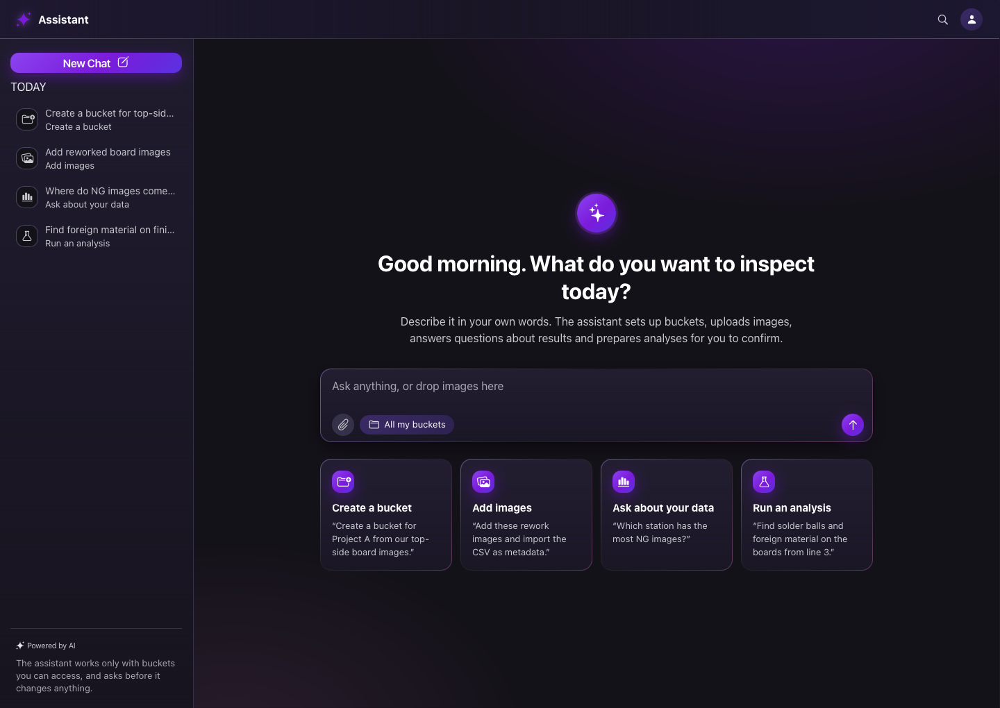
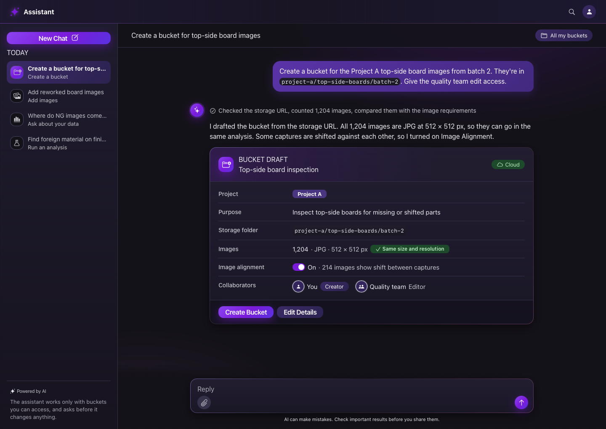
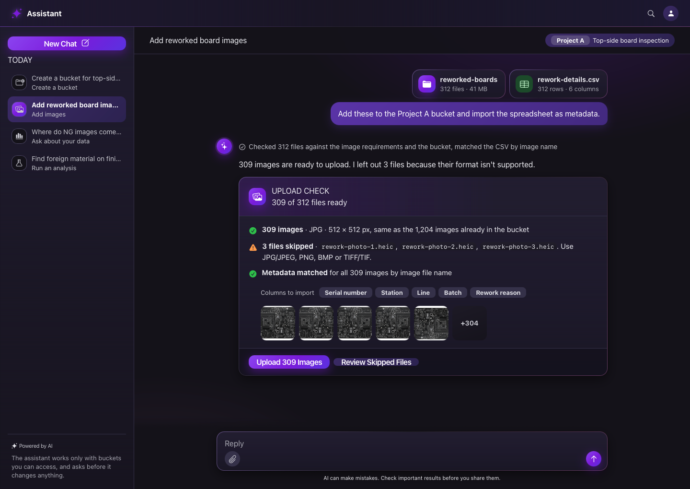
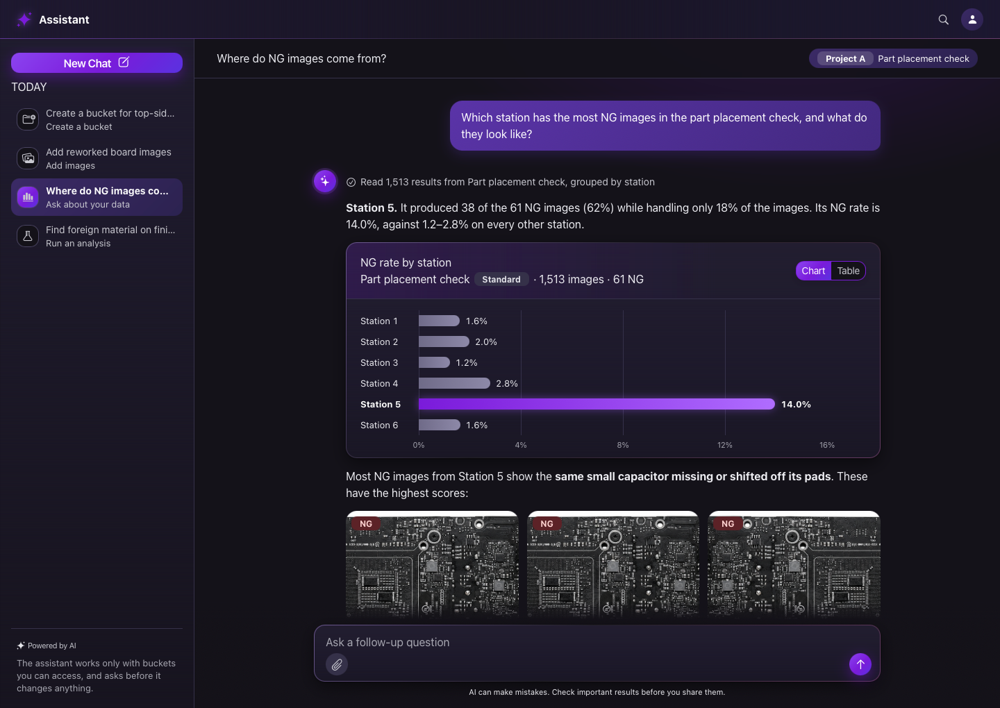
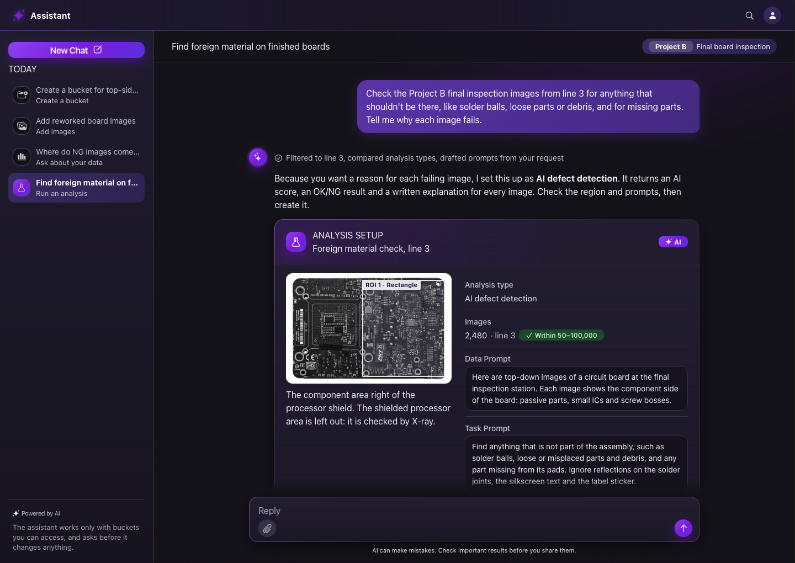

An AI chat that lets quality engineers run a visual-inspection platform in plain language: create buckets, upload images, ask questions about results and set up AI analyses, without hunting through forms and menus. Every action is drafted by the assistant and confirmed by the user.

## The problem {#problem}

Inspection platforms are powerful but form-heavy. To answer a simple question such as "Where are my defects coming from?", an engineer has to know which bucket, which analysis type, which filters and which analysis view to open.

| Pain point | Effect |
| --- | --- |
| Many steps per task | Creating a bucket or an analysis means long multi-step forms |
| Expert vocabulary | Analysis types, regions of interest and prompts need training to set up well |
| Answers spread across views | Charts, image galleries and tables each live on a different page |
| Upload errors found late | Wrong formats or mismatched image sizes show up after the upload |

## Goals {#goals}

| Goal | How the design answers it |
| --- | --- |
| Lower the effort per task | One request in plain language replaces a multi-step form |
| Keep the engineer in control | The assistant drafts; nothing happens until the user confirms |
| Make AI reasoning visible | Each answer shows the steps the assistant took and the data it used |
| Answer in context | Charts, image examples and tables appear inside the conversation |
| Fit the existing product | Results link back to the full pages for deeper work |

## Key scenarios {#scenarios}

One example per scenario, each ending in a confirmable action card.

| Scenario | User asks | Assistant responds with |
| --- | --- | --- |
| Create a bucket | "Create a bucket from these images in our cloud storage and share it with my team." | A pre-filled bucket draft: source, image count, format check, alignment setting, collaborators. A confirm button creates it. |
| Add images | Drops a folder and a metadata file: "Add these and import the metadata." | An upload check: files ready, files skipped with the reason, metadata matched, a preview strip. One click uploads. |
| Ask about the data | "Which station has the most defective images, and what do they look like?" | A direct answer first, then a bar chart (with a table toggle), the top-scoring images and links to the full analysis. |
| Run an analysis | "Find foreign material on these boards and explain why each image fails." | A recommended AI analysis type, a drawn region of interest, drafted prompts and settings. After confirmation, results with a written explanation per image. |

### Create a bucket

### Add images

### Ask about the data

### Run an analysis

## Interaction principles {#principles}

| Principle | In the interface |
| --- | --- |
| Draft, then confirm | Every action is a card with a primary confirm button and an edit option |
| Show the work | A collapsed "steps" line above each answer lists what was checked |
| Answer first, detail second | The first sentence answers the question; charts and images back it up |
| Explain the choice | When the assistant picks an option (e.g. an analysis type), it says why |
| Suggest the next step | Follow-up chips after each answer keep the flow moving |
| Honest limits | A persistent note reminds users that AI can make mistakes |

## Visual language {#visual}

A dark, gradient-led look that signals "AI tool" while staying readable for long sessions.

| Element | Decision |
| --- | --- |
| Theme | Dark surfaces with soft gradient panels instead of flat grey |
| Primary colour | Purple, used as a filled background behind white text |
| Text | White and light grey only; every text pair at or above WCAG AA (4.5:1) |
| Controls | All buttons, tags and chips have filled backgrounds |
| Shape | 12px corner radius (16px on cards), generous inner padding (12px minimum) |
| AI identity | Gradient orb with a sparkle for assistant messages, glowing primary actions |
| Data | Single-colour bar chart with the key bar highlighted, value labels on every bar, table view for accessibility |

## Benefits (expected) {#benefits}

| For | Benefit |
| --- | --- |
| Engineers | Faster first answers; fewer forms; errors caught before upload |
| New users | No need to learn the full vocabulary to get started |
| Teams | Consistent setups, because the assistant drafts from the same rules every time |
| The product | A new entry point that leads users into existing, more powerful pages |

## Challenges and how they were handled {#challenges}

:::principles
### Trust in automated actions
No silent actions: every change is a visible draft with an explicit confirm.
### Explaining AI choices
Short rationale lines and a "steps" summary on every answer.
### Showing rich data in a chat
Structured cards (fields, checks, charts, tables) instead of long text.
### Contrast on a dark theme
Purple kept for fills only; text moved to white and light grey after contrast checks.
### Consistency with an existing design system
Theme applied through token overrides on one page, so shared components follow without changes elsewhere.
### Presentation-ready content
Fictional, internally consistent demo data and generic sample images, so screens can be shown publicly.
:::

## Prototype details {#prototype}

| Aspect | Details |
| --- | --- |
| Screens | Welcome, Create bucket, Add images, Ask about data, Run analysis |
| States | Each action has a pending and a completed state (shareable by URL) |
| Interactions | Confirm → "thinking" → outcome; chart / table toggle; chart tooltips |
| Built with | Plain HTML, CSS and JavaScript on a lightweight prototyping canvas |

*Names, data and brand details are fictional or omitted to protect confidentiality.*
