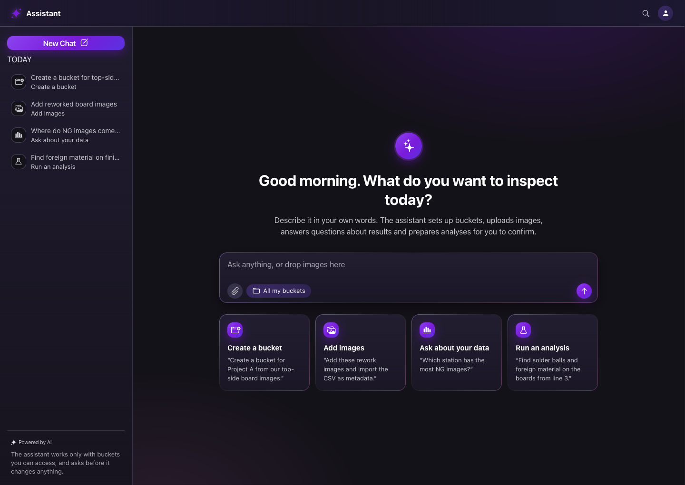
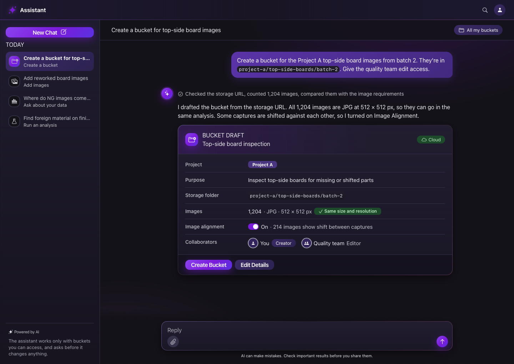
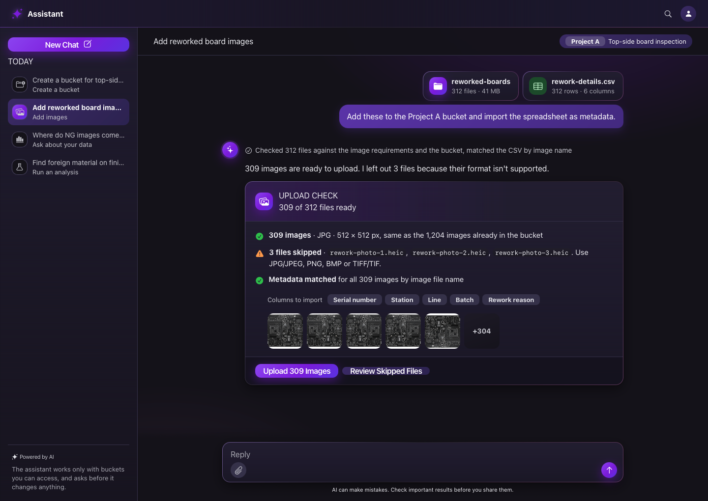
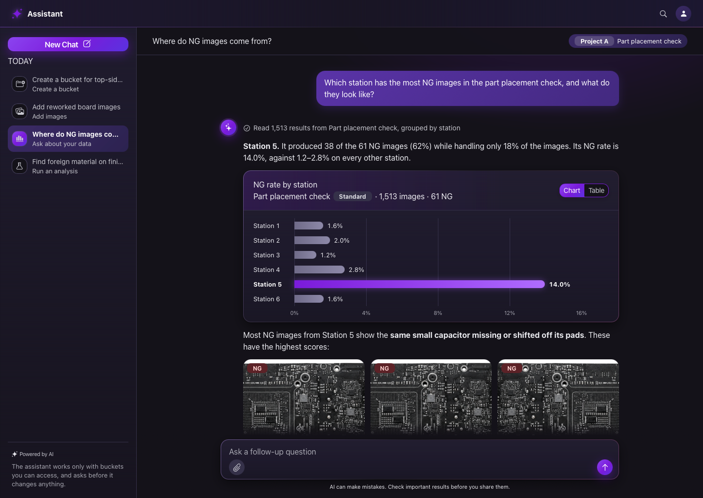
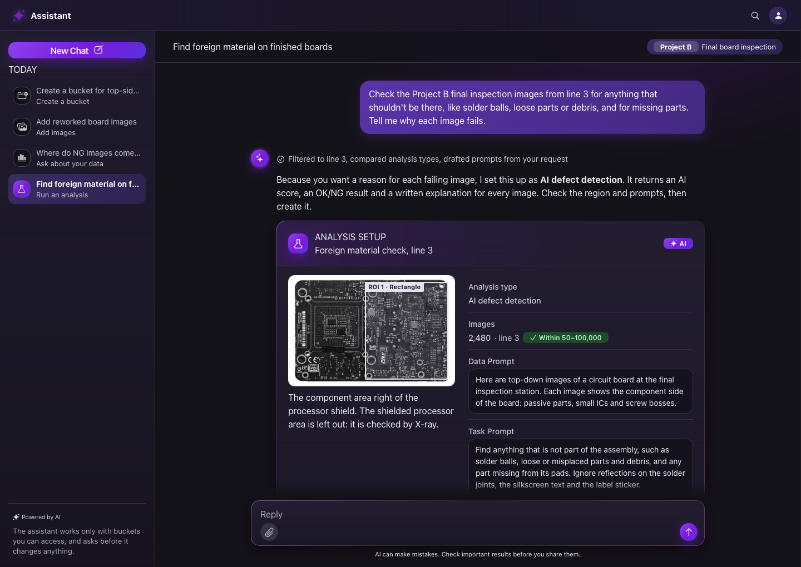

Um chat com IA que permite a engenheiros de qualidade operar uma plataforma de inspeção visual em linguagem natural: criar buckets, enviar imagens, fazer perguntas sobre os resultados e configurar análises com IA, sem procurar por formulários e menus. Cada ação é rascunhada pelo assistente e confirmada pelo usuário.

## O problema {#problem}

Plataformas de inspeção são poderosas, mas cheias de formulários. Para responder a uma pergunta simples como "De onde vêm meus defeitos?", o engenheiro precisa saber qual bucket, qual tipo de análise, quais filtros e qual visualização de análise abrir.

| Ponto de dor | Efeito |
| --- | --- |
| Muitas etapas por tarefa | Criar um bucket ou uma análise significa formulários longos, em várias etapas |
| Vocabulário especializado | Tipos de análise, regiões de interesse e prompts exigem treinamento para serem bem configurados |
| Respostas espalhadas | Gráficos, galerias de imagens e tabelas ficam cada um em uma página diferente |
| Erros de upload descobertos tarde | Formatos errados ou tamanhos de imagem diferentes só aparecem depois do envio |

## Objetivos {#goals}

| Objetivo | Como o design responde |
| --- | --- |
| Reduzir o esforço por tarefa | Um pedido em linguagem natural substitui um formulário de várias etapas |
| Manter o engenheiro no controle | O assistente rascunha; nada acontece até o usuário confirmar |
| Tornar o raciocínio da IA visível | Cada resposta mostra as etapas que o assistente seguiu e os dados que usou |
| Responder no contexto | Gráficos, exemplos de imagens e tabelas aparecem dentro da conversa |
| Encaixar no produto existente | Os resultados levam de volta às páginas completas para um trabalho mais profundo |

## Cenários principais {#scenarios}

Um exemplo por cenário, cada um terminando em um card de ação para confirmar.

| Cenário | O usuário pede | O assistente responde com |
| --- | --- | --- |
| Criar um bucket | "Crie um bucket com estas imagens do nosso armazenamento em nuvem e compartilhe com meu time." | Um rascunho de bucket preenchido: origem, quantidade de imagens, verificação de formato, alinhamento, colaboradores. Um botão de confirmação cria o bucket. |
| Adicionar imagens | Solta uma pasta e um arquivo de metadados: "Adicione estes e importe os metadados." | Uma verificação de upload: arquivos prontos, arquivos ignorados com o motivo, metadados associados, uma faixa de pré-visualização. Um clique envia. |
| Perguntar sobre os dados | "Qual estação tem mais imagens com defeito, e como elas são?" | Primeiro uma resposta direta, depois um gráfico de barras (com alternância para tabela), as imagens com maior pontuação e links para a análise completa. |
| Executar uma análise | "Encontre material estranho nestas placas e explique por que cada imagem reprova." | Um tipo de análise com IA recomendado, uma região de interesse desenhada, prompts e configurações rascunhados. Após a confirmação, resultados com uma explicação escrita por imagem. |

### Criar um bucket

### Adicionar imagens

### Perguntar sobre os dados

### Executar uma análise

## Princípios de interação {#principles}

| Princípio | Na interface |
| --- | --- |
| Rascunhar, depois confirmar | Cada ação é um card com um botão principal de confirmação e uma opção de edição |
| Mostrar o trabalho | Uma linha recolhida de "etapas" acima de cada resposta lista o que foi verificado |
| Resposta primeiro, detalhe depois | A primeira frase responde à pergunta; gráficos e imagens a sustentam |
| Explicar a escolha | Quando o assistente escolhe uma opção (por exemplo, um tipo de análise), ele diz por quê |
| Sugerir o próximo passo | Chips de continuação após cada resposta mantêm o fluxo em movimento |
| Limites honestos | Uma nota permanente lembra que a IA pode cometer erros |

## Linguagem visual {#visual}

Um visual escuro, guiado por gradientes, que sinaliza "ferramenta de IA" e continua legível em sessões longas.

| Elemento | Decisão |
| --- | --- |
| Tema | Superfícies escuras com painéis em gradiente suave em vez de cinza chapado |
| Cor primária | Roxo, usado como fundo preenchido atrás de texto branco |
| Texto | Apenas branco e cinza claro; todos os pares de texto em WCAG AA (4,5:1) ou acima |
| Controles | Todos os botões, tags e chips têm fundo preenchido |
| Forma | Cantos com raio de 12px (16px nos cards), espaçamento interno generoso (mínimo de 12px) |
| Identidade da IA | Orbe em gradiente com um brilho nas mensagens do assistente, ações principais com brilho |
| Dados | Gráfico de barras de uma cor com a barra principal destacada, valores em todas as barras, visualização em tabela para acessibilidade |

## Benefícios (esperados) {#benefits}

| Para | Benefício |
| --- | --- |
| Engenheiros | Primeiras respostas mais rápidas; menos formulários; erros identificados antes do upload |
| Novos usuários | Não é preciso aprender todo o vocabulário para começar |
| Times | Configurações consistentes, porque o assistente rascunha sempre com as mesmas regras |
| O produto | Uma nova porta de entrada que leva os usuários às páginas existentes, mais completas |

## Desafios e como foram resolvidos {#challenges}

:::principles
### Confiança em ações automáticas
Nenhuma ação silenciosa: cada mudança é um rascunho visível com uma confirmação explícita.
### Explicar as escolhas da IA
Linhas curtas de justificativa e um resumo de "etapas" em cada resposta.
### Mostrar dados ricos em um chat
Cards estruturados (campos, verificações, gráficos, tabelas) em vez de textos longos.
### Contraste em um tema escuro
O roxo ficou restrito a preenchimentos; o texto passou para branco e cinza claro após verificações de contraste.
### Consistência com um design system existente
Tema aplicado por meio de sobrescrita de tokens em uma única página, para que os componentes compartilhados acompanhem sem mudanças em outros lugares.
### Conteúdo pronto para apresentação
Dados de demonstração fictícios e internamente consistentes, e imagens de exemplo genéricas, para que as telas possam ser mostradas publicamente.
:::

## Detalhes do protótipo {#prototype}

| Aspecto | Detalhes |
| --- | --- |
| Telas | Boas-vindas, Criar bucket, Adicionar imagens, Perguntar sobre os dados, Executar análise |
| Estados | Cada ação tem um estado pendente e um concluído (compartilháveis por URL) |
| Interações | Confirmar → "pensando" → resultado; alternância gráfico / tabela; tooltips no gráfico |
| Feito com | HTML, CSS e JavaScript puros em um canvas de prototipação leve |

*Nomes, dados e detalhes de marca são fictícios ou foram omitidos para proteger a confidencialidade.*
