Quality teams spend their day inside dense tools: long forms to set up an analysis, tables of results, and hundreds of factory images to inspect side by side. When every screen invents its own buttons, spacing and image viewer, those tools become harder to learn and slower to build.

:::callout
Built on Ant Design, a proven, enterprise-grade foundation for atoms and heavy data tables, so the design and development effort went where these products are unique: images, complex flows and AI.
:::

## At a glance {#structure}

The system follows atomic design, from tokens to full pages, with two specialized sections on top. Open a layer to see what it holds.

:::accordion
### Foundations {TOKENS}
Design tokens mapped onto the Ant Design theme, inherited by everything above.
- Color: yellow accent, ink text, surfaces, status colors and tints
- Typography: system font stack and an eight-step type ramp
- Layout and columns for a 1440px desktop viewport
- Spacing, sizes and shape: one 2 / 4 / 8 / 16 scale, 12px corners
### Components {ATOMS · MOLECULES}
The building blocks, based on Ant Design and styled with the system tokens.
- Buttons, links and icon buttons
- Fields: text, selects, checkboxes, radios, switches, file drop, date-time, coordinates
- Badges, chips, tags and pills
- People and avatars
- Tooltips, toasts, progress, banners and upload status
### Patterns {ORGANISMS}
Larger pieces that combine components into working parts of a screen.
- Row tables, filter bars, filter panels and facets
- Details and action rows, history
- Modals, dialogs and sheets
- Fieldsets, option rows and option cards
### Templates {PAGES}
Page skeletons that new screens start from.
- Home
- List page and dense list page
- Form page and sheet form
### Image tools {SPECIALIZED}
The image components behind the main ML analysis product.
- Stage, toolbar and gallery
- Image details
- Region of interest
- Image comparison
- Measurements
### AI sub-system {SUB-SYSTEM}
A separate visual dialect for AI features and generated content.
- AI guidelines and tokens
- AI buttons
- AI panel
- AI marks in regular UI
:::

## Overview {#overview}

This is a regular design system, built with **atomic design**. It starts from foundations (color, typography, layout and spacing), builds them into small components such as buttons, fields and tags, combines those into larger patterns such as filter bars, tables and dialogs, and ends in page templates. The templates can be applied to different setups and applications, so a new screen starts from a working skeleton instead of a blank page.

It was made mainly for **web applications in desktop view**. The tools it serves are used at a desk, on large screens, for long working sessions.

Ant Design was the starting point, not the finished system. Many adjustments and additions were made to its original structure to fit the needs of the client projects. Two of them show this best:

- **An image tools section**, the backbone of the main product using the system: a tool that runs machine-learning analyses over factory images and samples.
- **An AI sub-system**, a distinct visual language that marks AI-powered features and AI-generated content.

Everything lives in a live showcase: every token and component is interactive, with the exact markup to copy.

### Standing on Ant Design

I didn't start from a blank canvas. The system is built on **Ant Design**, a mature open-source design system made for enterprise, data-heavy applications. Its atoms (buttons, inputs, selects, checkboxes, menus) and its tables (sorting, filtering, pagination, selection, fixed columns) are already accessible, documented and tested in many real products, with a React library developers already know.

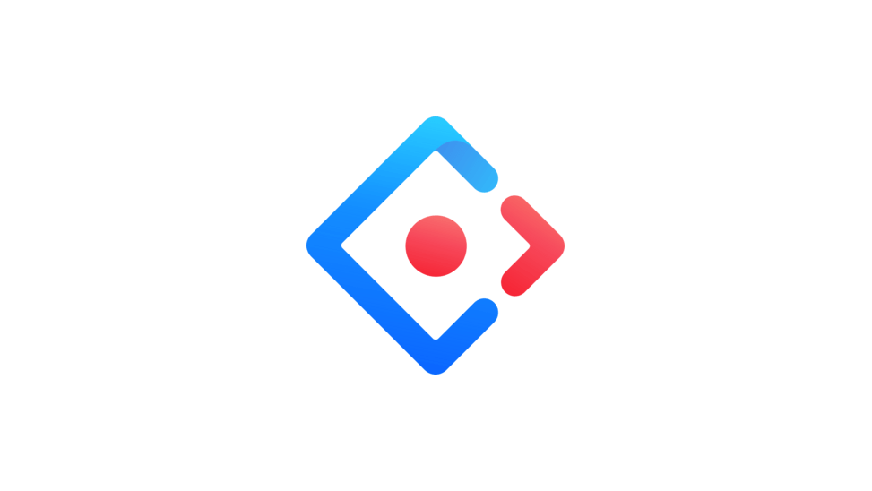

Rebuilding those pieces would have cost months and added no value for users. Using a solid base let me:

- **Save development effort:** engineers build with components they already know, instead of maintaining a custom version of every input and table.
- **Start from proven behavior:** keyboard support, states, validation and edge cases come built in, so they don't have to be redesigned.
- **Invest where it matters:** the time saved went into what no library offers: the image tools, the complex creation flows and the AI sub-system.

Building on Ant Design doesn't mean skipping design system work. I defined the foundations as design tokens (accent color, type ramp, the 2 / 4 / 8 / 16 spacing scale, 12px corners) and mapped them onto Ant Design's theme. Molecules, patterns and templates were designed for these products. Documentation, usage rules and the live showcase came on top. The result looks and works like its own system, on a base that's already proven.

The image tools and the AI sub-system are the clearest examples of that work. Ant Design has no components for browsing, comparing, marking or measuring factory images, and no visual language for AI features. These, along with many smaller adjustments such as the row table, the option cards and the full-screen sheets, were designed and added to the original structure because the client projects needed them. The base stayed standard where it already worked, and grew where the products asked for more.

## The problem {#problem}

The products this system supports share a few demanding traits:

:::cards
### Dense, technical forms
Setting up an analysis means many fields, dependent choices and validation, and the form still has to stay readable.
### Data-heavy tables
Results, collaborators and automations all live in tables people scan, sort, filter and act on.
### Images at the center
Most of the work happens on images: browsing, comparing, marking regions and measuring. Generic UI kits don't cover any of it.
### AI everywhere, but not always obvious
AI features sit next to regular ones. Users need to know when they are acting on, or reading, something an AI produced.
### Many screens, many hands
Several tools and contributors need to build screens that look and behave the same way.
:::

## Goals {#goals}

1. **One consistent foundation.** A single set of tokens for color, type, spacing and shape that every component and template inherits.
2. **Built for the desktop workday.** Comfortable density, clear hierarchy and layouts tuned for large screens.
3. **Complex content without complexity.** Forms, tables and image tools that stay readable as they grow.
4. **Images first.** Image components treated as core parts of the library, not as one-off custom screens.
5. **Make AI recognizable.** A clear visual signal for AI features and generated content, so users trust it for the right reasons.

## Foundations {#foundations}

### Color

One warm yellow does all the interactive work, and gradients of it carry emphasis. Everything else stays quiet: near-black ink on white, with light warm greys for structure.

| Role | Token | Value | Used for |
| --- | --- | --- | --- |
| Accent | `--ds-accent` | #edb13a | Fills: checks, selection, active rules, badges |
| Accent text | `--ds-accent-text` | #7a4d00 | Text you can click: links, text buttons (7:1 on white) |
| On accent | `--ds-on-accent` | #2e1f00 | Ink on accent fills such as filled buttons |
| Ink | `--ds-text-strong` | #1f1a10 | Titles and static text |
| Info | `--ds-info` | #2563eb | Info banners. Kept blue so it never reads as an action |
| Warning | `--ds-warning` | #ea580c | Warnings. Kept orange so they never read as the accent |
| Danger | `--ds-danger` | #b51f2e | Destructive actions and errors |

Two rules keep the accent readable. Accent text appears only where it can be clicked, and in a deep shade with high contrast. Static text stays ink, and when it needs to stand out it gets bold, not color.

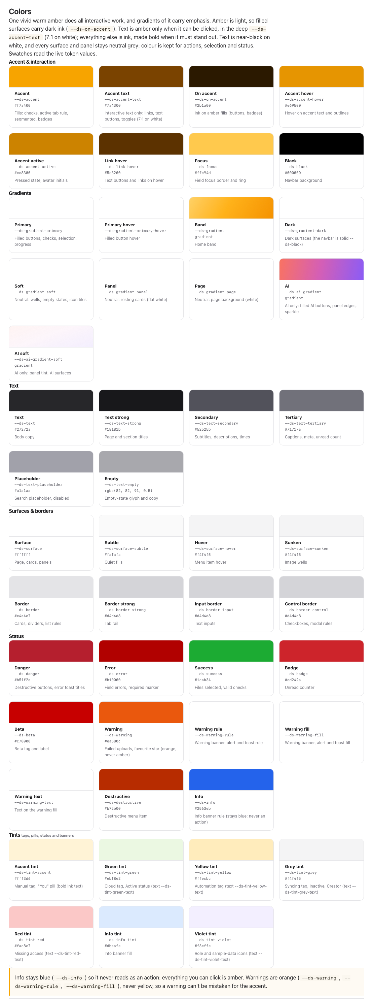
### Typography

The system uses the platform's own font stack (`system-ui`, then Segoe UI, Roboto, Helvetica Neue and Arial), so text looks native on every desktop and there are no font files to load.

| Style | Size / line height | Weight | Used for |
| --- | --- | --- | --- |
| Title 1 | 28 / 32 | Regular | Page titles |
| Title 2 | 23 / 32 | Bold | Display headings |
| Title 3 | 19 / 24 | Regular | Panel and modal titles |
| Title 4 | 15 / 24 | Bold | Section titles |
| Body | 16 / 24 | Regular | Body copy |
| Body small | 14 / 21 | Regular | Subtitles, secondary copy |
| Footnote | 12 / 18 | Regular | Descriptions, metadata |
| Caption | 11 / 16.5 | Regular | Captions, hints |

Headings are tight-tracked. Secondary copy is smaller and grey rather than lighter in weight.

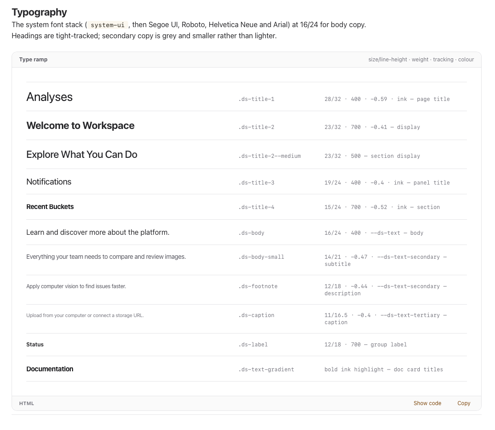
### Layout and columns

Screens are designed for a 1440px desktop viewport, with a small set of layout rules:

- **Page:** 64px padding on standard pages, 24px gutters on dense, full-width pages.
- **Navbar:** a 56px bar with its links centered in a 1000px band.
- **Forms:** the middle half of the page (at least 560px), with paired fields in two columns 32px apart.
- **Card grids:** three cards to a row, 16px apart.
- **Image work:** a stage in the center, with fixed side columns for thumbnails (168px) and details panels (320–360px).

### Spacing and shape

Every spacing value and every control size sits on one scale: **2, 4, 8, 16, 24, 32, 40, 48**, then steps of 8. Nothing in between.

Control heights follow the same scale: fields and large buttons are 40px, compact controls 32px, tags and small avatars 24px. A button placed next to a field always takes the field's 40px height, so the row reads as one line. Every corner is 12px; only pills, avatars and radio buttons are fully round.

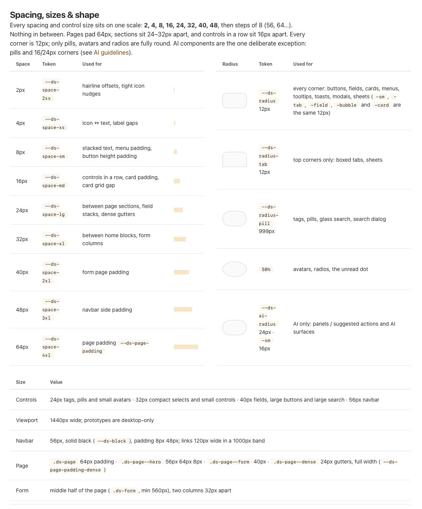

## Key components {#components}

### Buttons

Buttons come in three colors, each in three styles. **Accent** carries the flow: filled is the one primary action of a screen, outlined is its companion, and text is for low-emphasis actions in panels and toolbars. **Neutral** is for actions that shouldn't compete with the primary one, such as Cancel or Back. **Danger** is only for actions that delete or can't be undone. Every style has a disabled state. The default size is 32px, 40px is used for page actions and any button beside a field, and 24px for panel footers. AI actions never use these buttons; they have their own AI pills.

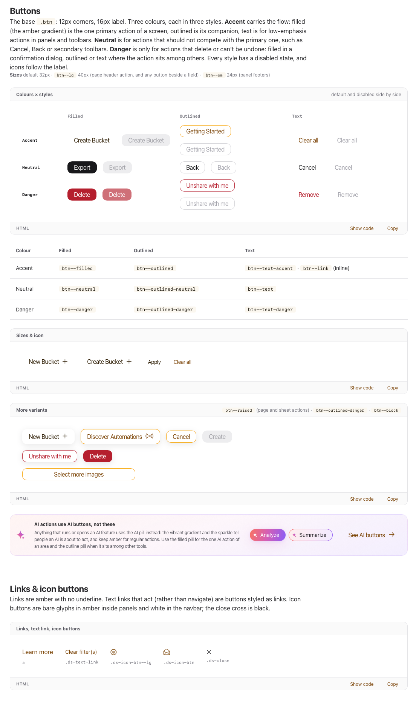
### Forms

The form set covers everything an analysis setup needs: text fields, searchable and soft selects, checkboxes, radios and switches, a file drop area, a date-time field and a coordinates field that accepts comma-separated values. Every field shares the same 40px height, label and help text styles.

## Built for complex content {#complex}

The system was designed to hold the heaviest parts of these products without losing clarity:

- **Complex forms:** strong fields with inline help, required markers and live counters; grouped fieldsets for fields that work together; option rows and option cards for choices that change what the form asks next; and full-screen sheets for long creation flows.
- **Tables:** a row table where each row is its own card, with sortable headers, selected and flagged states, and inline controls such as role pickers and remove buttons. Filter bars, filter panels and facets narrow large collections.
- **Images:** an entire section of image components, because the main product built on the system is image-oriented. It runs ML analyses over factory images and samples, so browsing, comparing, marking and measuring images happen on almost every screen.

## Image tools {#image-tools}

Image components are used frequently throughout the system, so they all share one layout. People always know where to look, whichever tool they open:

- **Navigation on the left:** a column of thumbnails with its own vertical scroll. Users move through a set of images without leaving the tool, and the selected image is highlighted.
- **The image in the center:** a stage that centers and zooms the image, with the **toolbar below the image container**. The pager, zoom slider and quick actions such as download sit there, so they never cover the image.
- **Data on the right:** a panel with the image's metadata and related data, such as serial number, size, dimensions, device, location and review result, along with tags, analyses, comments and measurements.

On top of that layout, the system offers a set of tools:

- **Stage, toolbar and gallery:** the core set every other tool reuses: thumbnails, stage and toolbar working together.
- **Image details:** the image large on the left, with everything known about it in the right panel as tabs: metadata, bucket, tags, analyses, comments, measurements and parametric keys. The modal keeps a fixed height and scrolls inside.
- **Region of interest:** users draw rectangles or polygons directly on the image to tell an analysis where to look, name each region on the spot, or type exact coordinates.
- **Image comparison:** six ways to look at two images: Side by Side, Highlights, Fade, Slider, Difference and Images Data.
- **Measurements:** a scale reference turns pixels into physical units, then length, area and angle tools measure directly on the image.

### Why the dotted background

Every image sits on a dotted canvas. Factory images often have plain backgrounds (white, light grey, dark) that are very close to the colors of the interface. On a flat background, the edge of the image would disappear and users could mistake part of the background for the sample, or the other way around. The dot pattern never appears in a photo, so the boundary between image and interface is always clear, at any zoom level.

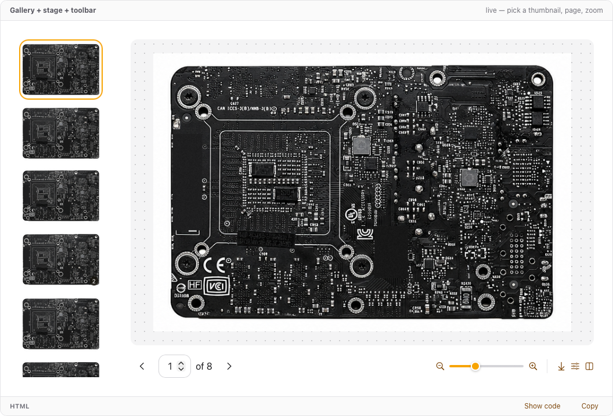

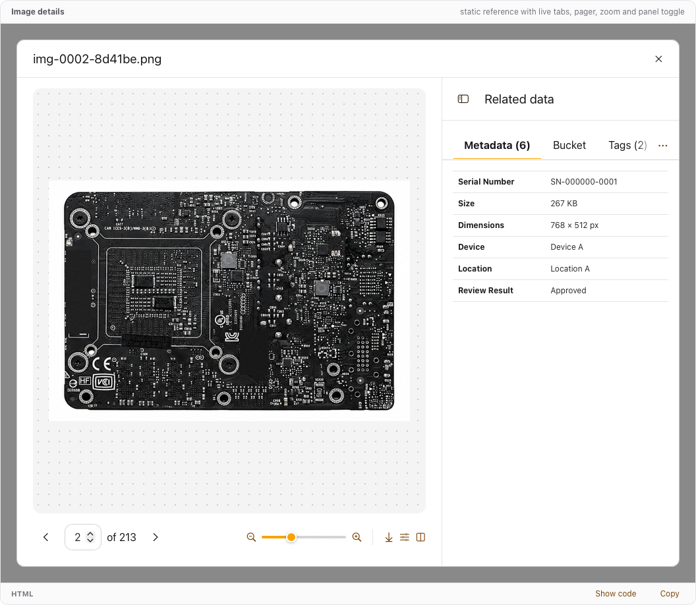

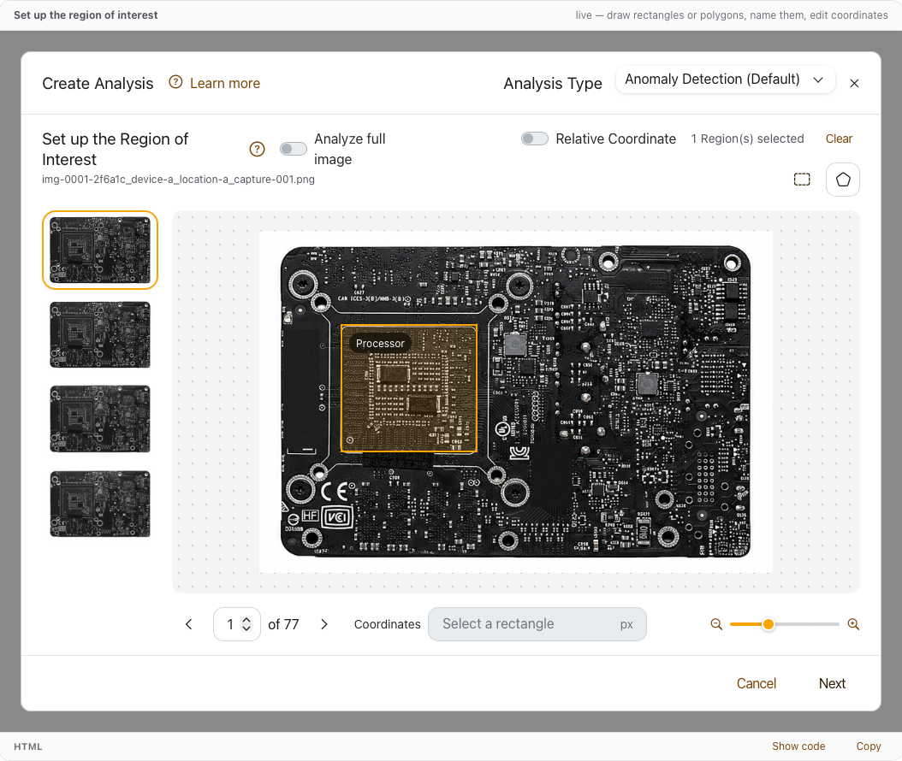

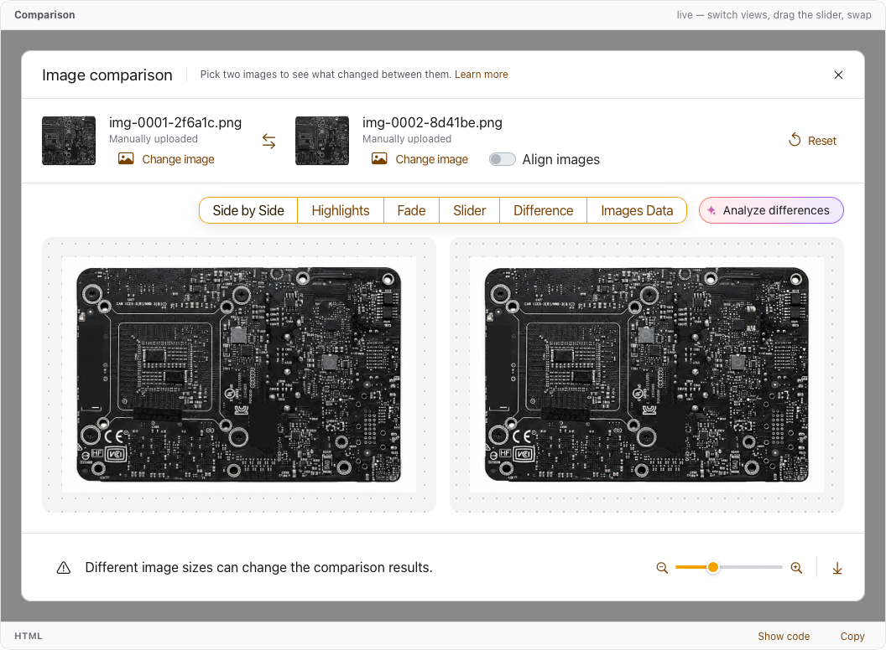

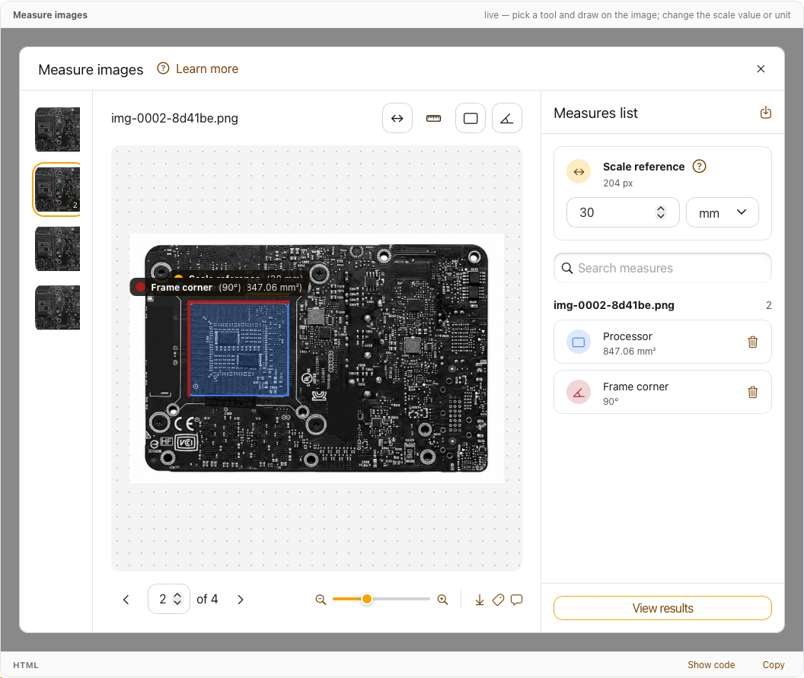
## The AI sub-system {#ai}

AI features have their own dialect inside the system, designed to stand apart from everything else on the page:

- **Vibrant gradient:** a coral → magenta → violet gradient, reserved for AI. It is never used on regular actions.
- **Glass surfaces:** AI answers appear in frosted-glass panels with a gradient edge and a soft glow, floating over the work they describe.
- **Rounder shapes:** AI actions are pills, and AI panels use 24px corners. This is the one deliberate exception to the 12px rule.
- **The sparkle:** every AI trigger, option, heading and answer carries a sparkle icon, in place of labels like "Powered by AI".

This dialect does three jobs:

- **Draws attention** to the AI tools the products introduce, so people discover them.
- **Identifies generated content**, so users know when they are reading an AI output and check it before acting. Every answer ends with feedback and a note that it was generated by AI, which helps prevent errors.
- **Matches what users already know:** sparkles and vibrant gradients are widely used to mark AI in external AI tools, so users recognize them without explanation.

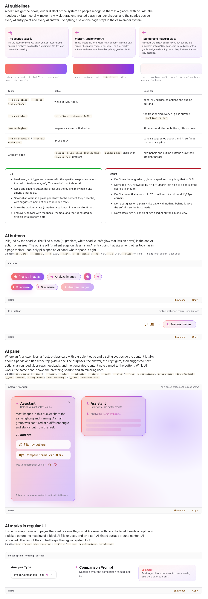
## Challenges and how I solved them {#challenges}

:::principles
### A light accent color that stays readable
The yellow accent is warm and calm, but too light for text on white or for white text on top. I split it into roles: the accent for fills with dark ink on top, a deep shade of it for clickable text, and ink for everything static.
### One scale for every size
Values like 6, 10, 12 and 20px crept in from many sources. I moved every spacing value and control height onto a single 2 / 4 / 8 / 16… scale, and made buttons match the height of the fields beside them.
### Images that read clearly against the UI
Factory images often share their background color with the interface. The dotted stage gives every image a clear edge without adding borders or frames.
### Separating AI without breaking consistency
AI needed to stand out without looking like a different product. A small, strictly scoped set of tokens (gradient, glass, glow, rounder corners and the sparkle) keeps it recognizable and keeps it in one place.
:::

## What I learned {#learned}

:::cards
### A strong base is a design decision
Building on Ant Design let me spend effort on what makes these products unique, instead of rebuilding what already works.
### Foundations do most of the work
A strict scale and a small palette removed most of the visual decisions from each new screen.
### Image tools deserve their own section
Treating images as first-class components made the most-used screens the most consistent ones.
### Background is part of the image
A background that can't be confused with content changes how confidently people read an image.
### AI needs a visual signature
A clear, familiar signal for generated content builds trust and prompts users to verify before acting.
:::

*Names, data and brand details are fictional or omitted to protect confidentiality.*
