Equipes de qualidade passam o dia dentro de ferramentas densas: formulários longos para configurar uma análise, tabelas de resultados e centenas de imagens de fábrica para inspecionar lado a lado. Quando cada tela inventa seus próprios botões, espaçamentos e visualizador de imagens, essas ferramentas ficam mais difíceis de aprender e mais lentas de construir.

:::callout
Construído sobre o Ant Design, uma base comprovada e de nível corporativo para átomos e tabelas de dados pesadas, para que o esforço de design e desenvolvimento fosse para o que esses produtos têm de único: imagens, fluxos complexos e IA.
:::

## Visão rápida {#structure}

O sistema segue o atomic design, dos tokens às páginas completas, com duas seções especializadas por cima. Abra uma camada para ver o que ela contém.

:::accordion
### Fundamentos {TOKENS}
Design tokens mapeados no tema do Ant Design, herdados por tudo o que vem acima.
- Cor: destaque amarelo, texto em tinta, superfícies, cores de status e tons
- Tipografia: pilha de fontes do sistema e uma escala tipográfica de oito níveis
- Layout e colunas para uma viewport desktop de 1440px
- Espaçamento, tamanhos e forma: uma escala 2 / 4 / 8 / 16, cantos de 12px
### Componentes {ÁTOMOS · MOLÉCULAS}
Os blocos básicos, baseados no Ant Design e estilizados com os tokens do sistema.
- Botões, links e botões de ícone
- Campos: texto, selects, checkboxes, rádios, switches, área de arquivos, data e hora, coordenadas
- Badges, chips, tags e pills
- Pessoas e avatares
- Tooltips, toasts, progresso, banners e status de upload
### Padrões {ORGANISMOS}
Peças maiores que combinam componentes em partes funcionais de uma tela.
- Tabelas em linhas, barras de filtro, painéis de filtro e facetas
- Linhas de detalhes e de ação, histórico
- Modais, diálogos e sheets
- Fieldsets, linhas de opção e cards de opção
### Templates {PÁGINAS}
Esqueletos de página dos quais as novas telas partem.
- Home
- Página de lista e página de lista densa
- Página de formulário e formulário em sheet
### Ferramentas de imagem {ESPECIALIZADO}
Os componentes de imagem por trás do principal produto de análise com ML.
- Palco, barra de ferramentas e galeria
- Detalhes da imagem
- Região de interesse
- Comparação de imagens
- Medições
### Subsistema de IA {SUBSISTEMA}
Um dialeto visual separado para funcionalidades de IA e conteúdo gerado.
- Diretrizes e tokens de IA
- Botões de IA
- Painel de IA
- Marcas de IA na UI comum
:::

## Visão geral {#overview}

Este é um design system convencional, construído com **atomic design**. Ele parte dos fundamentos (cor, tipografia, layout e espaçamento), transforma-os em componentes pequenos como botões, campos e tags, combina-os em padrões maiores como barras de filtro, tabelas e diálogos, e termina em templates de página. Os templates podem ser aplicados a diferentes configurações e aplicações, então uma nova tela começa de um esqueleto funcional em vez de uma página em branco.

Ele foi feito principalmente para **aplicações web em visualização desktop**. As ferramentas que ele atende são usadas em uma mesa, em telas grandes, durante longas sessões de trabalho.

O Ant Design foi o ponto de partida, não o sistema final. Muitos ajustes e adições foram feitos à sua estrutura original para atender às necessidades dos projetos dos clientes. Dois deles mostram isso melhor:

- **Uma seção de ferramentas de imagem**, a espinha dorsal do principal produto que usa o sistema: uma ferramenta que executa análises de machine learning sobre imagens e amostras de fábrica.
- **Um subsistema de IA**, uma linguagem visual própria que identifica funcionalidades com IA e conteúdo gerado por IA.

Tudo fica em um showcase ao vivo: cada token e componente é interativo, com o markup exato para copiar.

### Apoiado no Ant Design

Não comecei do zero. O sistema é construído sobre o **Ant Design**, um design system open source maduro, feito para aplicações corporativas e cheias de dados. Seus átomos (botões, campos, selects, checkboxes, menus) e suas tabelas (ordenação, filtros, paginação, seleção, colunas fixas) já são acessíveis, documentados e testados em muitos produtos reais, com uma biblioteca React que os desenvolvedores já conhecem.

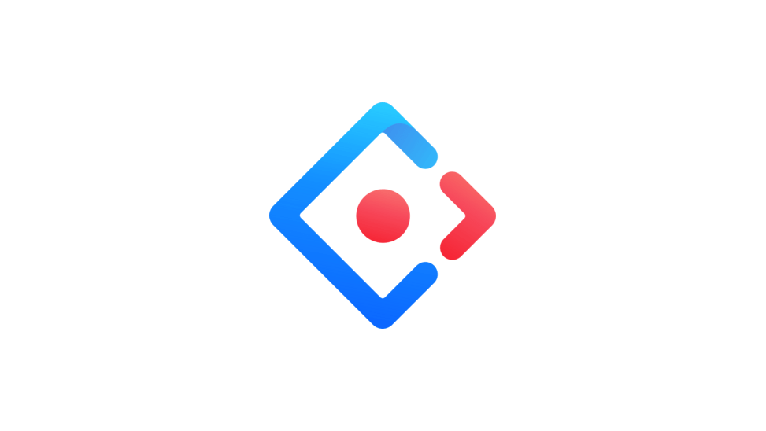

Reconstruir essas peças custaria meses e não traria nenhum valor para os usuários. Usar uma base sólida me permitiu:

- **Economizar esforço de desenvolvimento:** os engenheiros constroem com componentes que já conhecem, em vez de manter uma versão própria de cada campo e tabela.
- **Partir de um comportamento comprovado:** suporte a teclado, estados, validação e casos extremos já vêm prontos, sem precisar ser redesenhados.
- **Investir onde importa:** o tempo economizado foi para o que nenhuma biblioteca oferece: as ferramentas de imagem, os fluxos de criação complexos e o subsistema de IA.

Construir sobre o Ant Design não significa pular o trabalho de design system. Defini os fundamentos como design tokens (cor de destaque, escala tipográfica, a escala de espaçamento 2 / 4 / 8 / 16, cantos de 12px) e os mapeei no tema do Ant Design. Moléculas, padrões e templates foram desenhados para esses produtos. Documentação, regras de uso e o showcase ao vivo vieram por cima. O resultado parece e funciona como um sistema próprio, sobre uma base já comprovada.

As ferramentas de imagem e o subsistema de IA são os exemplos mais claros desse trabalho. O Ant Design não tem componentes para navegar, comparar, marcar ou medir imagens de fábrica, nem uma linguagem visual para funcionalidades de IA. Esses recursos, junto com muitos ajustes menores, como a tabela em linhas, os cards de opção e os sheets em tela cheia, foram desenhados e adicionados à estrutura original porque os projetos dos clientes precisavam deles. A base continuou padrão onde já funcionava e cresceu onde os produtos pediam mais.

## O problema {#problem}

Os produtos que este sistema atende compartilham algumas características exigentes:

:::cards
### Formulários densos e técnicos
Configurar uma análise envolve muitos campos, escolhas dependentes e validação, e o formulário ainda precisa continuar legível.
### Tabelas cheias de dados
Resultados, colaboradores e automações ficam em tabelas que as pessoas percorrem, ordenam, filtram e sobre as quais agem.
### Imagens no centro
A maior parte do trabalho acontece sobre imagens: navegar, comparar, marcar regiões e medir. Kits de UI genéricos não cobrem nada disso.
### IA em todo lugar, mas nem sempre evidente
Funcionalidades de IA ficam ao lado das comuns. Os usuários precisam saber quando estão agindo sobre, ou lendo, algo produzido por uma IA.
### Muitas telas, muitas mãos
Várias ferramentas e colaboradores precisam construir telas com a mesma aparência e o mesmo comportamento.
:::

## Objetivos {#goals}

1. **Uma base consistente.** Um único conjunto de tokens de cor, tipografia, espaçamento e forma herdado por todo componente e template.
2. **Feito para o dia de trabalho no desktop.** Densidade confortável, hierarquia clara e layouts ajustados para telas grandes.
3. **Conteúdo complexo sem complicação.** Formulários, tabelas e ferramentas de imagem que continuam legíveis conforme crescem.
4. **Imagens em primeiro lugar.** Componentes de imagem tratados como partes centrais da biblioteca, e não como telas customizadas pontuais.
5. **Tornar a IA reconhecível.** Um sinal visual claro para funcionalidades de IA e conteúdo gerado, para que os usuários confiem nela pelos motivos certos.

## Fundamentos {#foundations}

### Cor

Um único amarelo quente faz todo o trabalho interativo, e gradientes dele carregam a ênfase. Todo o resto fica discreto: tinta quase preta sobre branco, com cinzas quentes claros para a estrutura.

| Papel | Token | Valor | Usado para |
| --- | --- | --- | --- |
| Destaque | `--ds-accent` | #edb13a | Preenchimentos: checks, seleção, regras ativas, badges |
| Texto de destaque | `--ds-accent-text` | #7a4d00 | Texto clicável: links, botões de texto (7:1 sobre branco) |
| Sobre destaque | `--ds-on-accent` | #2e1f00 | Tinta sobre preenchimentos na cor de destaque, como botões preenchidos |
| Tinta | `--ds-text-strong` | #1f1a10 | Títulos e texto estático |
| Informação | `--ds-info` | #2563eb | Banners informativos. Mantido azul para nunca parecer uma ação |
| Alerta | `--ds-warning` | #ea580c | Alertas. Mantido laranja para nunca parecer o destaque |
| Perigo | `--ds-danger` | #b51f2e | Ações destrutivas e erros |

Duas regras mantêm o destaque legível. Texto na cor de destaque aparece só onde é clicável, e em um tom escuro com alto contraste. Texto estático fica em tinta e, quando precisa se destacar, ganha negrito, não cor.

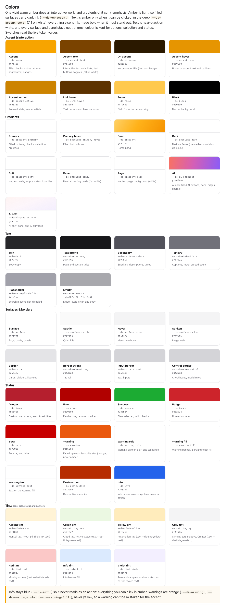
### Tipografia

O sistema usa a pilha de fontes da própria plataforma (`system-ui`, depois Segoe UI, Roboto, Helvetica Neue e Arial), então o texto parece nativo em qualquer desktop e não há arquivos de fonte para carregar.

| Estilo | Tamanho / altura de linha | Peso | Usado para |
| --- | --- | --- | --- |
| Título 1 | 28 / 32 | Regular | Títulos de página |
| Título 2 | 23 / 32 | Negrito | Títulos de destaque |
| Título 3 | 19 / 24 | Regular | Títulos de painéis e modais |
| Título 4 | 15 / 24 | Negrito | Títulos de seção |
| Corpo | 16 / 24 | Regular | Texto corrido |
| Corpo pequeno | 14 / 21 | Regular | Subtítulos, texto secundário |
| Nota | 12 / 18 | Regular | Descrições, metadados |
| Legenda | 11 / 16.5 | Regular | Legendas, dicas |

Os títulos têm espaçamento entre letras reduzido. O texto secundário é menor e cinza, em vez de mais leve no peso.

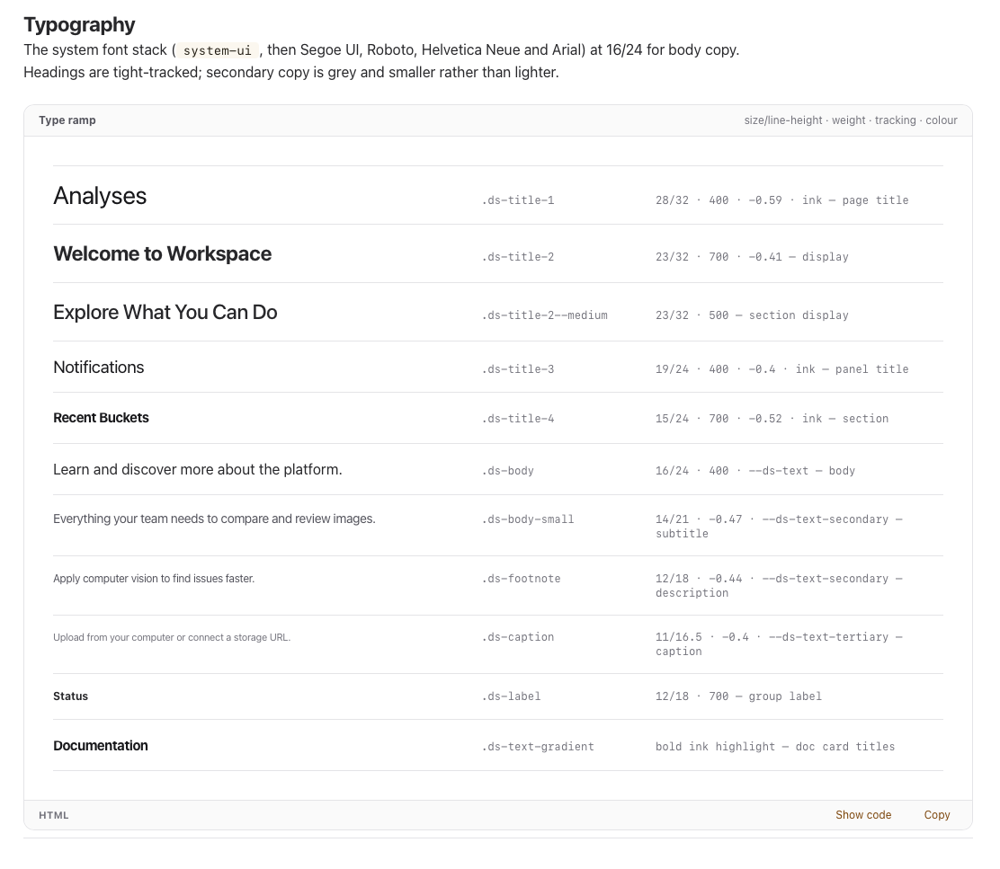
### Layout e colunas

As telas são desenhadas para uma viewport desktop de 1440px, com um pequeno conjunto de regras de layout:

- **Página:** 64px de padding nas páginas padrão, 24px de margem nas páginas densas de largura total.
- **Navbar:** uma barra de 56px com os links centralizados em uma faixa de 1000px.
- **Formulários:** a metade central da página (no mínimo 560px), com campos pareados em duas colunas a 32px de distância.
- **Grades de cards:** três cards por linha, a 16px de distância.
- **Trabalho com imagens:** um palco no centro, com colunas laterais fixas para miniaturas (168px) e painéis de detalhes (320–360px).

### Espaçamento e forma

Todo valor de espaçamento e todo tamanho de controle seguem uma única escala: **2, 4, 8, 16, 24, 32, 40, 48**, e depois passos de 8. Nada no meio.

As alturas dos controles seguem a mesma escala: campos e botões grandes têm 40px, controles compactos 32px, tags e avatares pequenos 24px. Um botão ao lado de um campo sempre assume os 40px do campo, para que a linha seja lida como uma só. Todo canto tem 12px; só pills, avatares e botões de rádio são totalmente arredondados.

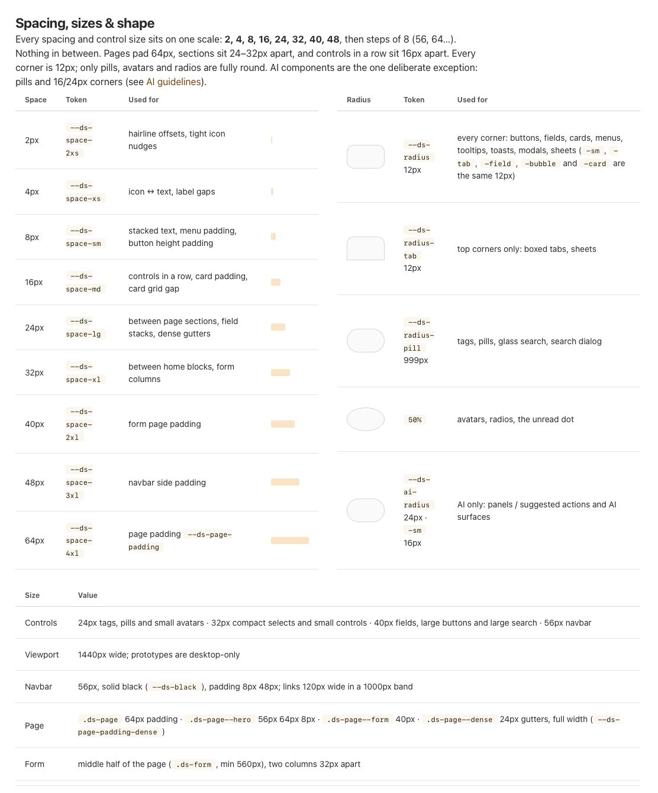

## Componentes principais {#components}

### Botões

Os botões vêm em três cores, cada uma em três estilos. **Destaque** conduz o fluxo: o preenchido é a única ação principal da tela, o contornado é seu complemento e o de texto é para ações de baixa ênfase em painéis e barras de ferramentas. **Neutro** é para ações que não devem competir com a principal, como Cancelar ou Voltar. **Perigo** é só para ações que excluem ou não podem ser desfeitas. Todo estilo tem um estado desabilitado. O tamanho padrão é 32px, 40px é usado em ações de página e em qualquer botão ao lado de um campo, e 24px em rodapés de painéis. Ações de IA nunca usam esses botões; elas têm suas próprias pills de IA.

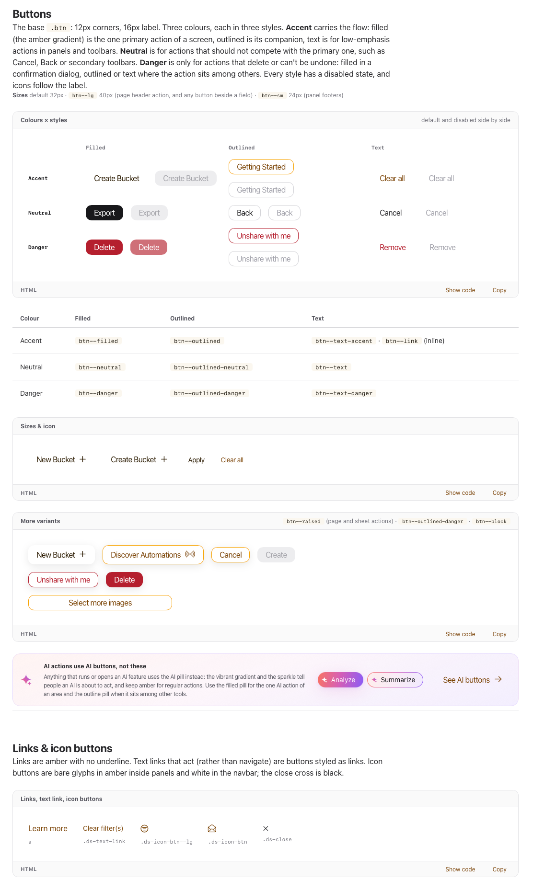
### Formulários

O conjunto de formulários cobre tudo o que a configuração de uma análise precisa: campos de texto, selects pesquisáveis e suaves, checkboxes, rádios e switches, uma área para soltar arquivos, um campo de data e hora e um campo de coordenadas que aceita valores separados por vírgula. Todos os campos compartilham a mesma altura de 40px e os mesmos estilos de rótulo e texto de ajuda.

## Feito para conteúdo complexo {#complex}

O sistema foi desenhado para comportar as partes mais pesadas desses produtos sem perder clareza:

- **Formulários complexos:** campos robustos com ajuda inline, marcadores de obrigatório e contadores ao vivo; fieldsets agrupados para campos que funcionam juntos; linhas e cards de opção para escolhas que mudam o que o formulário pede em seguida; e sheets em tela cheia para fluxos de criação longos.
- **Tabelas:** uma tabela em linhas em que cada linha é um card próprio, com cabeçalhos ordenáveis, estados de selecionado e sinalizado, e controles inline como seletores de função e botões de remover. Barras de filtro, painéis de filtro e facetas refinam coleções grandes.
- **Imagens:** uma seção inteira de componentes de imagem, porque o principal produto construído sobre o sistema é orientado a imagens. Ele executa análises de ML sobre imagens e amostras de fábrica, então navegar, comparar, marcar e medir imagens acontece em quase todas as telas.

## Ferramentas de imagem {#image-tools}

Os componentes de imagem são usados com frequência em todo o sistema, por isso todos compartilham um mesmo layout. As pessoas sempre sabem onde olhar, seja qual for a ferramenta que abrirem:

- **Navegação à esquerda:** uma coluna de miniaturas com rolagem vertical própria. Os usuários percorrem um conjunto de imagens sem sair da ferramenta, e a imagem selecionada fica destacada.
- **A imagem no centro:** um palco que centraliza e aplica zoom na imagem, com a **barra de ferramentas abaixo do container da imagem**. A paginação, o controle de zoom e ações rápidas como download ficam ali, então nunca cobrem a imagem.
- **Dados à direita:** um painel com os metadados e os dados relacionados da imagem, como número de série, tamanho, dimensões, dispositivo, local e resultado da revisão, junto com tags, análises, comentários e medições.

Sobre esse layout, o sistema oferece um conjunto de ferramentas:

- **Palco, barra de ferramentas e galeria:** o conjunto central que todas as outras ferramentas reutilizam: miniaturas, palco e barra de ferramentas funcionando juntos.
- **Detalhes da imagem:** a imagem grande à esquerda, com tudo o que se sabe sobre ela no painel da direita, em abas: metadados, bucket, tags, análises, comentários, medições e chaves paramétricas. O modal mantém uma altura fixa e rola por dentro.
- **Região de interesse:** os usuários desenham retângulos ou polígonos diretamente na imagem para indicar à análise onde olhar, nomeiam cada região na hora ou digitam coordenadas exatas.
- **Comparação de imagens:** seis formas de olhar duas imagens: Lado a lado, Destaques, Fade, Slider, Diferença e Dados das imagens.
- **Medições:** uma referência de escala converte pixels em unidades físicas, e então ferramentas de comprimento, área e ângulo medem diretamente na imagem.

### Por que o fundo pontilhado

Toda imagem fica sobre um canvas pontilhado. Imagens de fábrica costumam ter fundos lisos (branco, cinza claro, escuro) muito próximos das cores da interface. Em um fundo liso, a borda da imagem desapareceria e os usuários poderiam confundir parte do fundo com a amostra, ou o contrário. O padrão de pontos nunca aparece em uma foto, então o limite entre imagem e interface fica sempre claro, em qualquer nível de zoom.

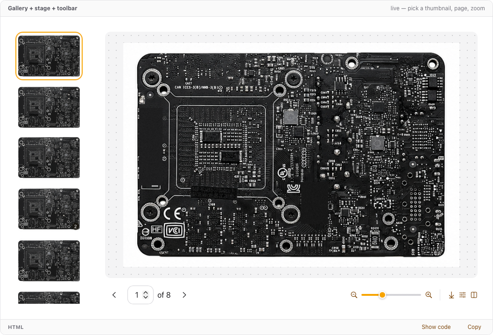

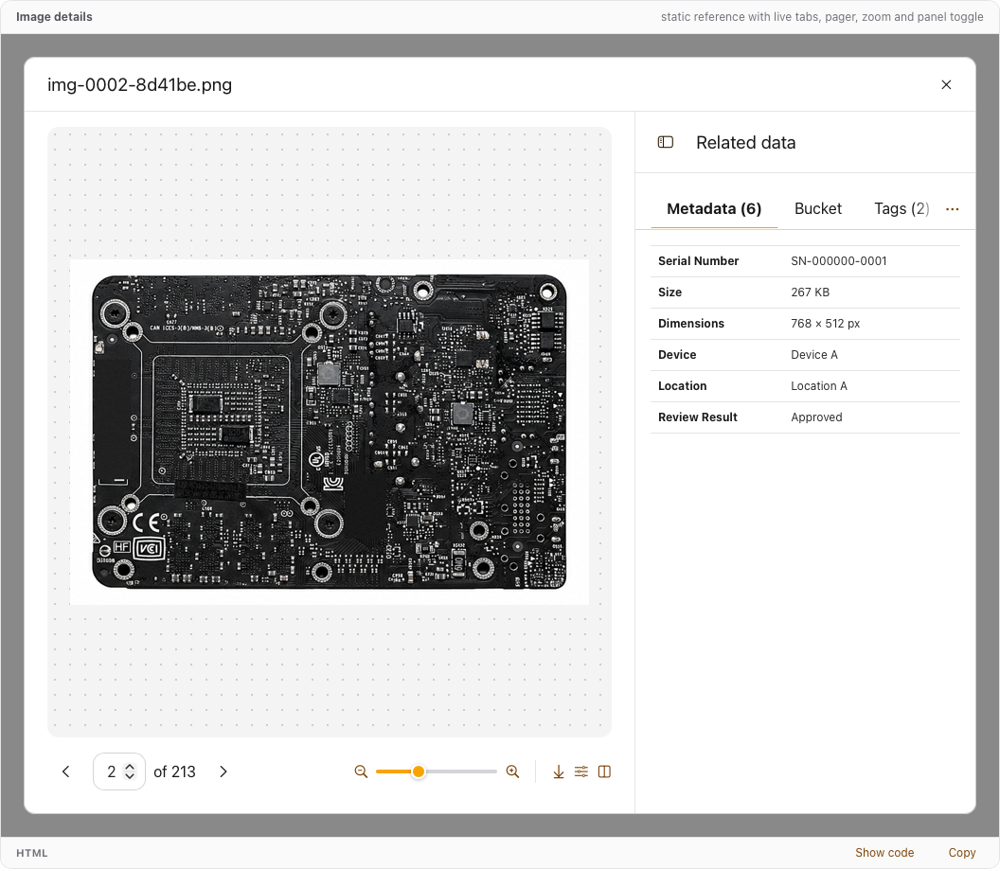

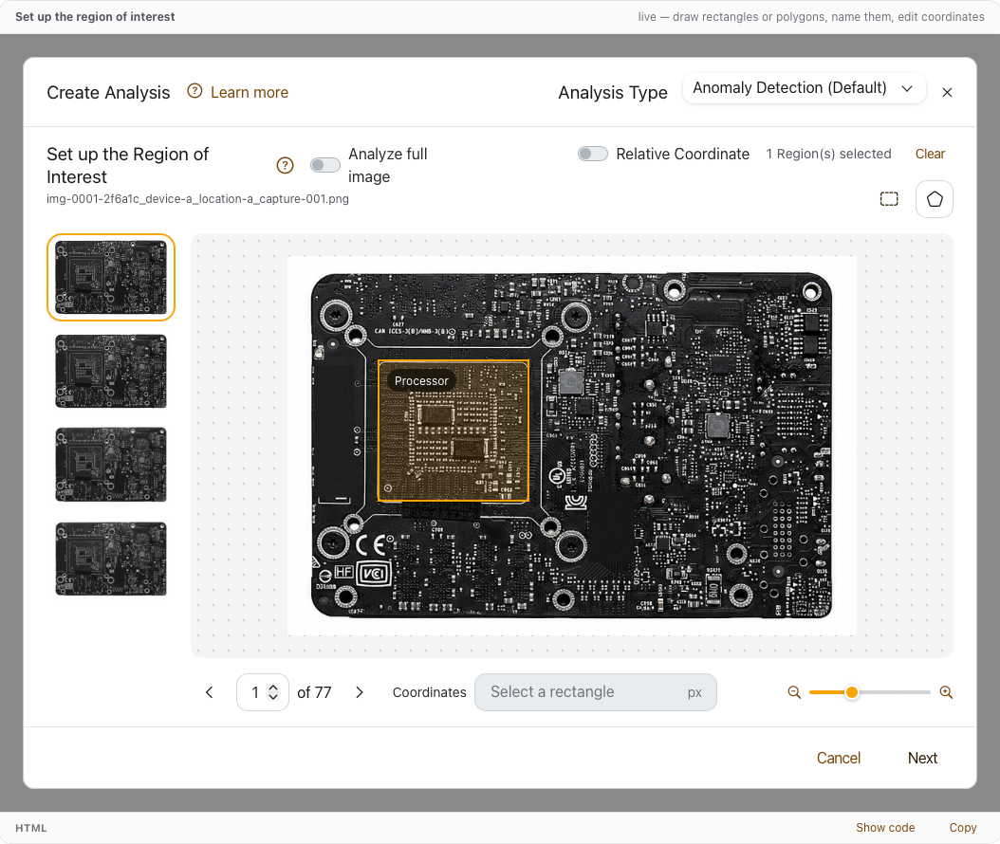

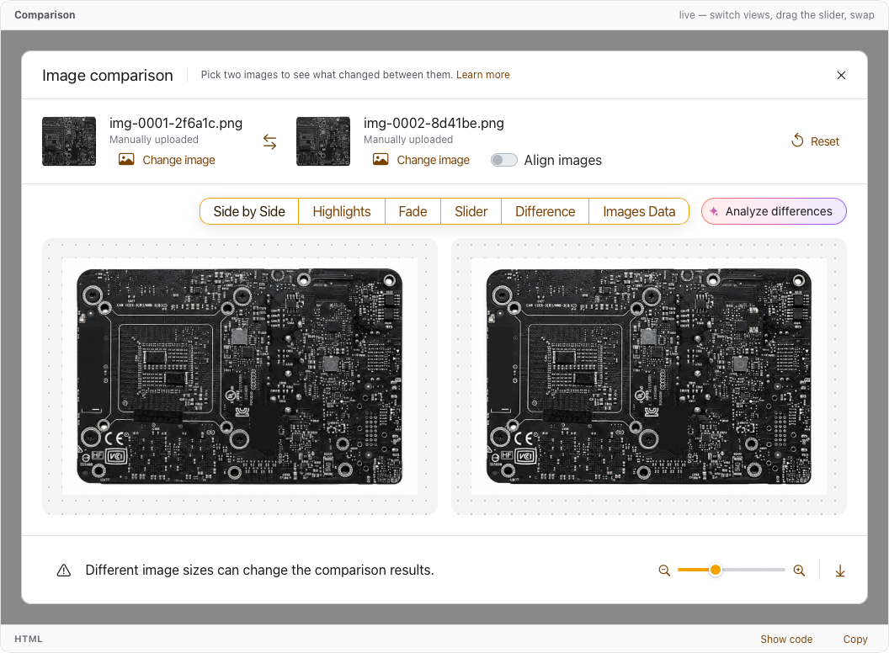

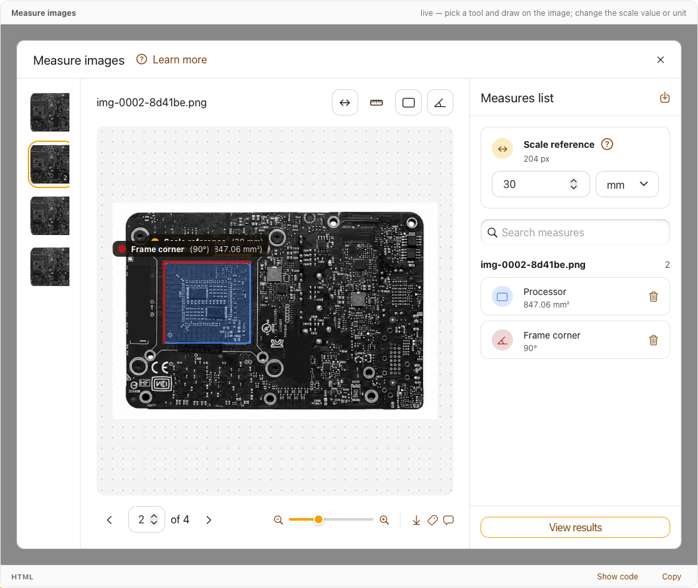
## O subsistema de IA {#ai}

As funcionalidades de IA têm seu próprio dialeto dentro do sistema, desenhado para se destacar de todo o resto da página:

- **Gradiente vibrante:** um gradiente coral → magenta → violeta, reservado para IA. Nunca é usado em ações comuns.
- **Superfícies de vidro:** as respostas da IA aparecem em painéis de vidro fosco com borda em gradiente e um brilho suave, flutuando sobre o trabalho que descrevem.
- **Formas mais arredondadas:** ações de IA são pills, e painéis de IA usam cantos de 24px. Esta é a única exceção deliberada à regra dos 12px.
- **O brilho:** todo gatilho, opção, título e resposta de IA leva um ícone de brilho (sparkle), no lugar de rótulos como "Powered by AI".

Esse dialeto cumpre três funções:

- **Chama a atenção** para as ferramentas de IA que os produtos introduzem, para que as pessoas as descubram.
- **Identifica conteúdo gerado**, para que os usuários saibam quando estão lendo uma saída de IA e a verifiquem antes de agir. Toda resposta termina com feedback e um aviso de que foi gerada por IA, o que ajuda a evitar erros.
- **Corresponde ao que os usuários já conhecem:** brilhos e gradientes vibrantes são amplamente usados para identificar IA em ferramentas externas, então os usuários os reconhecem sem explicação.

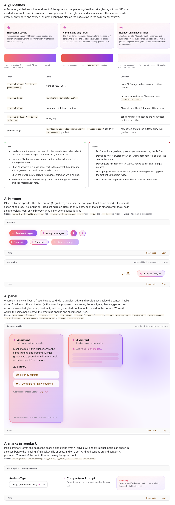
## Desafios e como foram resolvidos {#challenges}

:::principles
### Uma cor de destaque clara que continua legível
O amarelo de destaque é quente e calmo, mas claro demais para texto sobre branco ou para texto branco por cima. Dividi a cor em papéis: o destaque para preenchimentos com tinta escura por cima, um tom escuro dele para texto clicável e tinta para tudo o que é estático.
### Uma escala para todos os tamanhos
Valores como 6, 10, 12 e 20px tinham surgido de várias fontes. Movi todo valor de espaçamento e altura de controle para uma única escala 2 / 4 / 8 / 16… e fiz os botões acompanharem a altura dos campos ao lado.
### Imagens que se leem com clareza contra a UI
Imagens de fábrica costumam ter a mesma cor de fundo da interface. O palco pontilhado dá a toda imagem uma borda clara sem adicionar bordas ou molduras.
### Separar a IA sem quebrar a consistência
A IA precisava se destacar sem parecer outro produto. Um conjunto pequeno e estritamente delimitado de tokens (gradiente, vidro, brilho suave, cantos mais arredondados e o sparkle) a mantém reconhecível e concentrada em um só lugar.
:::

## O que aprendi {#learned}

:::cards
### Uma base sólida é uma decisão de design
Construir sobre o Ant Design me permitiu investir esforço no que torna esses produtos únicos, em vez de reconstruir o que já funciona.
### Os fundamentos fazem a maior parte do trabalho
Uma escala rígida e uma paleta pequena eliminaram a maioria das decisões visuais de cada nova tela.
### Ferramentas de imagem merecem sua própria seção
Tratar imagens como componentes de primeira classe tornou as telas mais usadas as mais consistentes.
### O fundo faz parte da imagem
Um fundo que não pode ser confundido com o conteúdo muda a confiança com que as pessoas leem uma imagem.
### A IA precisa de uma assinatura visual
Um sinal claro e familiar para conteúdo gerado cria confiança e incentiva os usuários a verificar antes de agir.
:::

*Nomes, dados e detalhes de marca são fictícios ou foram omitidos para proteger a confidencialidade.*
